# Third full run (version 7)

Saved output from the Colab run of notebook version 7: key printed text and every figure.
The code in the run is identical to the `v7` tag (jupytext .py forms compared; no cells changed in Colab).

## Cell 6: classifier training

```text
Extracted 154 positive sonnets.
107205 clean play windows.

--- Supervised Classifier: held-out ROC-AUC (5-fold CV) ---
  structural only: AUC = 0.974
  structural + TF-IDF: AUC = 0.981
  -> USE_TFIDF = False
Supervised Model Trained.

--- PU Classifier (Elkan & Noto) ---
  held-out AUC (labeled vs unlabeled) = 0.978
  Estimated c (held-out) = 0.405   [first version, in-sample + balanced weights: 0.981]
PU Model Trained.
Caveat: PU assumes labeled sonnets are a random sample of all sonnets. Play sonnets are
often 10-18 lines and split between speakers, so treat PU probabilities as a ranking.
```

## Cell 7: scan and exports

```text
--- Verification ---
Supervised: Friar=0.0455, Prologue=0.7653
PU:         Friar=0.0133, Prologue=0.4417

--- Scanning ALL Play Windows for Top Candidates ---
Scanning 107205 windows...

--- Exporting Top 2% Candidates ---
Supervised Top 2% Threshold: 0.8757
PU Top 2% Threshold: 0.7200
Count Supervised: 2145
Count PU: 2145
Count Intersection: 1952
Saved: sonnet_candidates_supervised.txt
Saved: sonnet_candidates_pu.txt
Saved: sonnet_candidates_intersection.txt
--- Generating Structured CSV ---

SUCCESS: Top 2% candidates stored in DataFrame 'sonnet_candidates_df' (2338 rows).
Columns: ['Play', 'Start_Line', 'End_Line', 'Supervised_Score', 'PU_Score', 'Is_Top_2_Pct_Sup', 'Is_Top_2_Pct_PU', 'Is_Intersection']
Saved CSV: sonnet_candidates_structured.csv
--- Generating Visualizations ---
```

**Figure 1.** Supervised scores for play windows vs held-out canonical sonnets (left); top-2% candidates across the corpus (right)

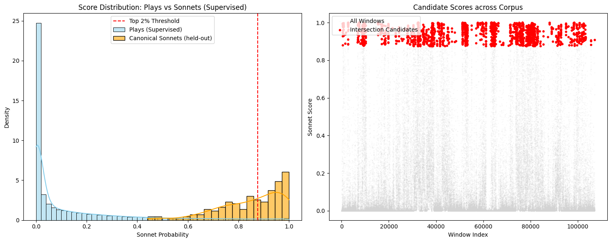

## Cell 8b: evaluation on the known play sonnets

```text
Located 21 of 22 known play sonnets in the cleaned plays.
Not in the corpus (cannot be recalled): ['Edward III, scene 2.322–3.']
                                          label                             play  line split
        The Two Gentlemen of Verona, 3.1.140–9.      THE TWO GENTLEMEN OF VERONA  1137  test
               The Comedy of Errors, 3.2.41–54.             THE COMEDY OF ERRORS   773  tune
                Love’s Labour’s Lost, 1.1.80–9.             LOVE’S LABOUR’S LOST   101  test
              Love’s Labour’s Lost, 1.1.159–74.             LOVE’S LABOUR’S LOST   183  test
              Love’s Labour’s Lost, 4.2.106–19.             LOVE’S LABOUR’S LOST  1132  test
               Love’s Labour’s Lost, 4.3.24–39.             LOVE’S LABOUR’S LOST  1198  test
               Love’s Labour’s Lost, 4.3.57–70.             LOVE’S LABOUR’S LOST  1232  tune
              Love’s Labour’s Lost, 5.2.401–15.             LOVE’S LABOUR’S LOST  2091  test
                    Romeo and Juliet, Prologue.  THE TRAGEDY OF ROMEO AND JULIET    31  tune
                  Romeo and Juliet, 1.5.92–109.  THE TRAGEDY OF ROMEO AND JULIET   700  test
Romeo and Juliet, 2.0. Introduction to Act Two.  THE TRAGEDY OF ROMEO AND JULIET   757  tune
         A Midsummer Night’s Dream, 5.1.108–17.        A MIDSUMMER NIGHT’S DREAM  1819  tune
            Much Ado About Nothing, 3.1.107–16.           MUCH ADO ABOUT NOTHING  1009  test
                             Henry V, Epilogue. THE LIFE OF KING HENRY THE FIFTH  3026  tune
                      As You Like It, 3.2.1–10.                   AS YOU LIKE IT  1079  tune
              Troilus and Cressida, 1.2.278–91.             TROILUS AND CRESSIDA   421  test
        All’s Well That Ends Well, 1.1.212–225.        ALL’S WELL THAT ENDS WELL   203  test
           All’s Well That Ends Well, 3.4.4–17.        ALL’S WELL THAT ENDS WELL  1411  test
                       Pericles, scene 10.1–14.         PERICLES, PRINCE OF TYRE  1051  tune
                     Pericles, scene 21.225–35.         PERICLES, PRINCE OF TYRE  2255  tune
                        Cymbeline, 5.5.187–204.                        CYMBELINE  2984  tune
=== Baseline: how well does each detector find the known play sonnets? ===
      detector  n_known  median_rank  recall@10  recall@25  recall@50  recall@100  recall@250 split
rule (WEIGHTS)       10         47.5      0.300      0.300      0.600       0.600       0.700  tune
rule (WEIGHTS)       11         13.0      0.455      0.636      0.727       0.727       0.909  test
supervised clf       10       2167.5      0.000      0.000      0.100       0.200       0.200  tune
supervised clf       11        445.0      0.000      0.091      0.091       0.091       0.273  test
        PU clf       10       2163.0      0.000      0.000      0.100       0.200       0.200  tune
        PU clf       11        467.0      0.000      0.091      0.091       0.091       0.273  test

95% bootstrap intervals over all 21 located sonnets:
  rule (WEIGHTS)   recall@50 = 0.67  [0.48, 0.86]   median rank = 38  [7, 124]
  supervised clf   recall@50 = 0.10  [0.00, 0.24]   median rank = 1054  [409, inf]
  PU clf           recall@50 = 0.10  [0.00, 0.24]   median rank = 1280  [394, inf]
Intervals this wide mean a difference of one or two sonnets is not a real difference.

Rank of each known sonnet (lower is better; inf = never in the hit list):
                                          label split  rule (WEIGHTS)  supervised clf  PU clf
        The Two Gentlemen of Verona, 3.1.140–9.  test            38.0             inf     inf
               The Comedy of Errors, 3.2.41–54.  tune             2.0             inf     inf
                Love’s Labour’s Lost, 1.1.80–9.  test             3.0             inf     inf
              Love’s Labour’s Lost, 1.1.159–74.  test            15.0            22.0    22.0
              Love’s Labour’s Lost, 4.2.106–19.  test            13.0           445.0   591.0
               Love’s Labour’s Lost, 4.3.24–39.  test            10.0             inf     inf
               Love’s Labour’s Lost, 4.3.57–70.  tune             inf             inf     inf
              Love’s Labour’s Lost, 5.2.401–15.  test             6.0           536.0   467.0
                    Romeo and Juliet, Prologue.  tune             7.0           595.0   586.0
                  Romeo and Juliet, 1.5.92–109.  test             1.0           239.0   214.0
Romeo and Juliet, 2.0. Introduction to Act Two.  tune             4.0            41.0    41.0
         A Midsummer Night’s Dream, 5.1.108–17.  tune            46.0             inf     inf
            Much Ado About Nothing, 3.1.107–16.  test           925.0          2891.0     inf
                             Henry V, Epilogue.  tune            42.0            83.0    76.0
                      As You Like It, 3.2.1–10.  tune            49.0          1332.0  1280.0
              Troilus and Cressida, 1.2.278–91.  test           124.0           359.0   363.0
        All’s Well That Ends Well, 1.1.212–225.  test           209.0           409.0   394.0
           All’s Well That Ends Well, 3.4.4–17.  test             5.0           232.0   210.0
                       Pericles, scene 10.1–14.  tune             inf          1054.0  1313.0
                     Pericles, scene 21.225–35.  tune           130.0          3003.0  3013.0
                        Cymbeline, 5.5.187–204.  tune             inf             inf     inf

rule (WEIGHTS): known sonnets outside the top 50
  Love’s Labour’s Lost, 4.3.57–70.         score 0.758 (top 0.27% of windows); suppressed by a stronger peak +4 lines away (0.830)
  Much Ado About Nothing, 3.1.107–16.      score 0.564 (top 7.09% of windows); scores too low on its own
  Troilus and Cressida, 1.2.278–91.        score 0.679 (top 1.02% of windows); suppressed by a stronger peak +2 lines away (0.724)
  All’s Well That Ends Well, 1.1.212–225.  score 0.681 (top 1.01% of windows); scores too low on its own
  Pericles, scene 10.1–14.                 score 0.354 (top 58.02% of windows); suppressed by a stronger peak -5 lines away (0.590)
  Pericles, scene 21.225–35.               score 0.470 (top 21.44% of windows); suppressed by a stronger peak -1 lines away (0.720)
  Cymbeline, 5.5.187–204.                  score 0.546 (top 7.96% of windows); suppressed by a stronger peak +7 lines away (0.701)
rule + PU (fused), tune: recall@50 0.20, median rank 151
rule + PU (fused), test: recall@50 0.64, median rank 24
  all 21: recall@50 = 0.43 [0.24, 0.62]
  SHORT_FORM_CREDIT = 0.75, tune: recall@50 0.60, median rank 48
  SHORT_FORM_CREDIT = 0.75, test: recall@50 0.73, median rank 13
  SHORT_FORM_CREDIT = 1.00, tune: recall@50 0.20, median rank inf
  SHORT_FORM_CREDIT = 1.00, test: recall@50 0.64, median rank 14
Change SHORT_FORM_CREDIT in cell 4 only if the TEST half improves.

Raw text near the first line of Edward III, scene 2.322–3.:
'And let me have her likened to the sun –' not found in the raw text

Tuned weights (chosen on the tune half): {'meter': np.float64(0.0), 'syllable': np.float64(0.1), 'rhyme': np.float64(0.1), 'couplet': np.float64(0.8)}
  tune: recall@50 0.60 -> 0.60; median rank 48 -> 44
  test: recall@50 0.73 -> 0.73; median rank 13 -> 13
If the TEST numbers improve, copy the tuned weights into WEIGHTS in cell 4 and re-run.
```

## Cell 9: THE SONNETS analysis

**Figure 2.** Rule-detector signal along THE SONNETS

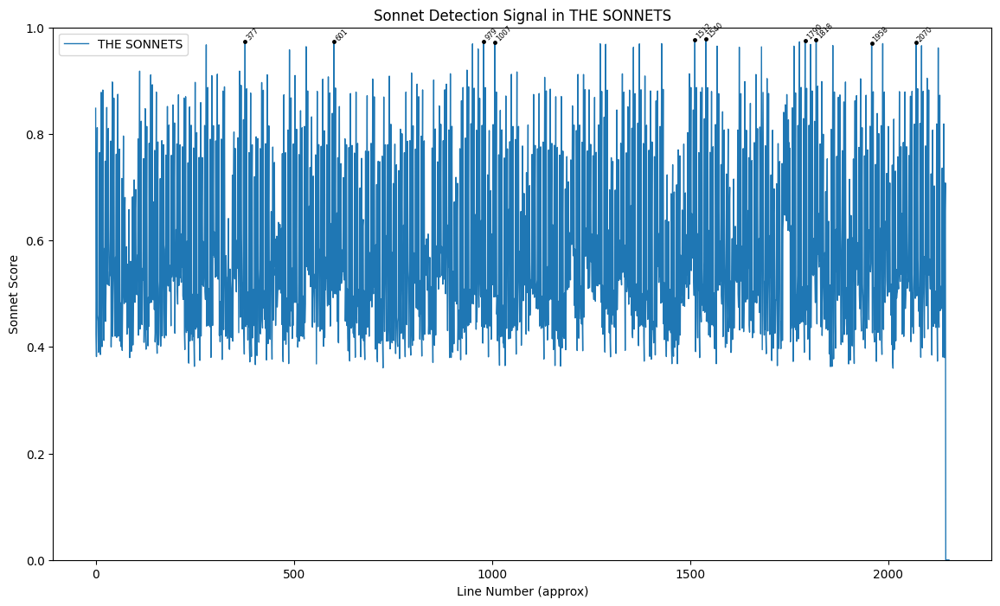

**Figure 3.** Scores of the 154 canonical sonnets and the 22 known play sonnets

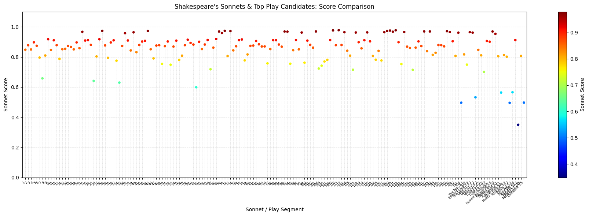

**Figure 4.** Sonnets ranked by score, marked by rhyme-scheme deviation

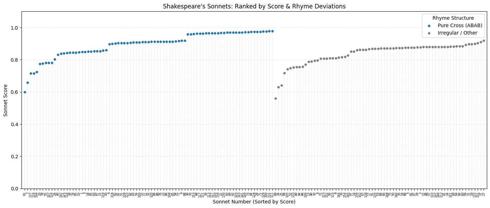

```text
----------------------------------------
EXAMPLES OF DEVIANT RHYME SCHEMES
----------------------------------------

> Contains Enclosed (ABBA)
  (No examples found)

> Contains Couplets (AABB)
  (No examples found)

> Irregular / Other
  (From Sonnet 2, Quatrain Type: Irregular)
    When forty winters shall besiege thy brow,
    And dig deep trenches in thy beauty’s field,
    Thy youth’s proud livery so gazed on now,
    Will be a tattered weed of small worth held:
```

**Figure 5.** How often each word is used in the Sonnets

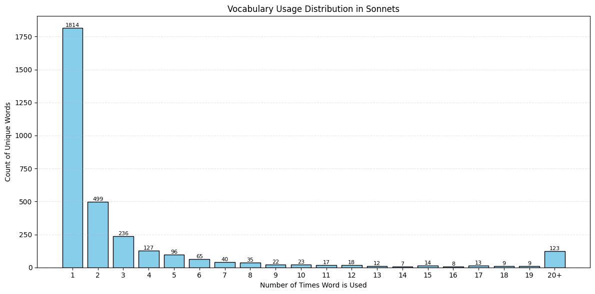

**Figure 6.** Sonnets clustered by rare-word usage: K-Means

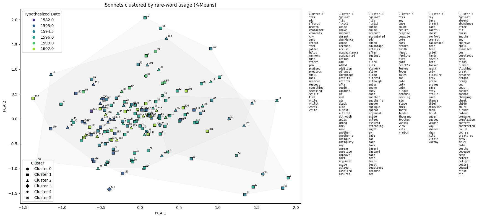

**Figure 7.** Sonnets clustered by rare-word usage: Agglomerative (Ward)


**Figure 8.** Ward dendrogram of the sonnets


**Figure 9.** Sonnets clustered by rare-word usage: Spectral


```text
============================================================
CLUSTER AGREEMENT ACROSS METHODS (Adjusted Rand Index)
============================================================
K-Means vs Agglomerative: ARI = 0.015
K-Means vs Spectral: ARI = -0.020
Agglomerative vs Spectral: ARI = 0.022
```

**Figure 10.** Cluster overlap by sonnets: K-Means vs Ward


**Figure 11.** Cluster overlap by sonnets: K-Means vs Spectral


```text
K-Means vs Agglomerative: Jaccard similarity of cluster WORD sets
  K-Means cluster 0 best matches Agglomerative cluster 1 with Jaccard = 0.062
  K-Means cluster 1 best matches Agglomerative cluster 2 with Jaccard = 0.729
  K-Means cluster 2 best matches Agglomerative cluster 2 with Jaccard = 0.582
  K-Means cluster 3 best matches Agglomerative cluster 3 with Jaccard = 0.163
  K-Means cluster 4 best matches Agglomerative cluster 0 with Jaccard = 0.073
  K-Means cluster 5 best matches Agglomerative cluster 1 with Jaccard = 0.250
K-Means vs Spectral: Jaccard similarity of cluster WORD sets
  K-Means cluster 0 best matches Spectral cluster 2 with Jaccard = 0.044
  K-Means cluster 1 best matches Spectral cluster 4 with Jaccard = 0.754
  K-Means cluster 2 best matches Spectral cluster 4 with Jaccard = 0.570
  K-Means cluster 3 best matches Spectral cluster 4 with Jaccard = 0.040
  K-Means cluster 4 best matches Spectral cluster 5 with Jaccard = 0.051
  K-Means cluster 5 best matches Spectral cluster 0 with Jaccard = 0.192
Agglomerative vs Spectral: Jaccard similarity of cluster WORD sets
  Agglomerative cluster 0 best matches Spectral cluster 4 with Jaccard = 0.468
  Agglomerative cluster 1 best matches Spectral cluster 4 with Jaccard = 0.375
  Agglomerative cluster 2 best matches Spectral cluster 4 with Jaccard = 0.678
  Agglomerative cluster 3 best matches Spectral cluster 0 with Jaccard = 0.243
  Agglomerative cluster 4 best matches Spectral cluster 1 with Jaccard = 0.361
  Agglomerative cluster 5 best matches Spectral cluster 0 with Jaccard = 0.155
```

**Figure 12.** Jaccard of cluster word sets: K-Means vs Ward


**Figure 13.** Jaccard of cluster word sets: K-Means vs Spectral

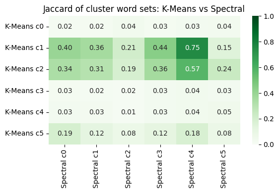

**Figure 14.** Jaccard of cluster word sets: Ward vs Spectral

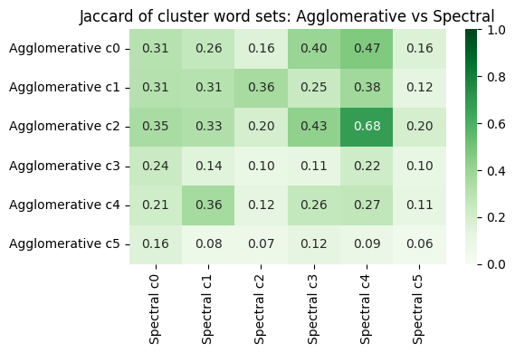

```text
 k        method  silhouette  null_sil_mean  null_sil_95  stability_ARI
 2       K-Means       0.002         -0.001        0.001         -0.009
 2 Agglomerative       0.001         -0.001        0.001          0.312
 2      Spectral       0.003         -0.001        0.001          0.066
 3       K-Means      -0.009         -0.005        0.000          0.017
 3 Agglomerative      -0.001         -0.005        0.000          0.246
 3      Spectral       0.002         -0.005        0.000          0.129
 4       K-Means      -0.007         -0.011       -0.006          0.029
 4 Agglomerative      -0.000         -0.011       -0.006          0.236
 4      Spectral       0.002         -0.011       -0.006          0.174
 5       K-Means      -0.005         -0.013       -0.006          0.026
 5 Agglomerative       0.000         -0.013       -0.006          0.308
 5      Spectral       0.001         -0.013       -0.006          0.136
 6       K-Means      -0.012         -0.014       -0.008          0.013
 6 Agglomerative       0.001         -0.014       -0.008          0.255
 6      Spectral       0.002         -0.014       -0.008          0.151
 7       K-Means      -0.009         -0.015       -0.008          0.038
 7 Agglomerative       0.001         -0.015       -0.008          0.312
 7      Spectral      -0.000         -0.015       -0.008          0.128
 8       K-Means      -0.015         -0.019       -0.012         -0.002
 8 Agglomerative       0.002         -0.019       -0.012          0.363
 8      Spectral       0.001         -0.019       -0.012          0.166
 9       K-Means      -0.011         -0.021       -0.016          0.028
 9 Agglomerative       0.000         -0.021       -0.016          0.343
 9      Spectral       0.001         -0.021       -0.016          0.181
10       K-Means      -0.014         -0.021       -0.013          0.045
10 Agglomerative      -0.003         -0.021       -0.013          0.340
10      Spectral      -0.001         -0.021       -0.013          0.133

Most stable: Agglomerative at k=8 (ARI 0.36).
Silhouette above the null AND above 0.05 for some k: False
Highest silhouette: 0.003 (0 = no separation; 0.25+ = weak structure)
Verdict: no stable rare-word cluster structure. Report this as the result;
the cluster word lists above should not be interpreted as themes.
```

**Figure 15.** Silhouette vs k against the shuffled-word null (left); bootstrap stability (right)

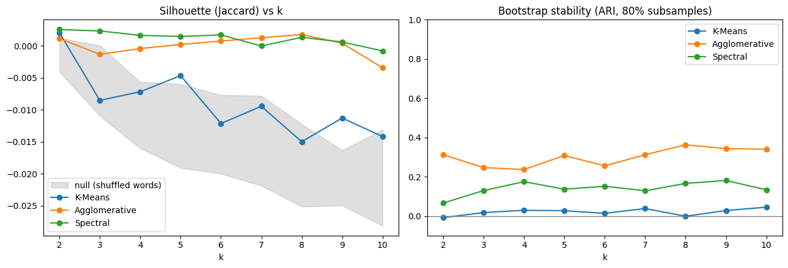

## Cell 10: Midsummer (top hits, statistics)

```text
Top 10 Scoring Segments in A MIDSUMMER NIGHT’S DREAM (Distinct Regions):
========================================

Rank 1 | Score: 0.8877 | Start Line: 2058
--------------------
[PUCK] Now the wasted brands do glow,
Whilst the screech-owl, screeching loud,
Puts the wretch that lies in woe
In remembrance of a shroud.
Now it is the time of night
That the graves, all gaping wide,
Every one lets forth his sprite,
In the church-way paths to glide.
And we fairies, that do run
By the triple Hecate’s team
From the presence of the sun,
Following darkness like a dream,
Now are frolic; not a mouse
Shall disturb this hallow’d house.

Rank 2 | Score: 0.8820 | Start Line: 1851
--------------------
[THESEUS] And as she fled, her mantle she did fall;
Which Lion vile with bloody mouth did stain.
Anon comes Pyramus, sweet youth, and tall,
And finds his trusty Thisbe’s mantle slain;
Whereat with blade, with bloody blameful blade,
He bravely broach’d his boiling bloody breast;
And Thisbe, tarrying in mulberry shade,
His dagger drew, and died. For all the rest,
Let Lion, Moonshine, Wall, and lovers twain,
At large discourse while here they do remain.
I wonder if the lion be to speak.
[DEMETRIUS] No wonder, my lord. One lion may, when many asses do.
[WALL] In this same interlude it doth befall
That I, one Snout by name, present a wall:

Rank 3 | Score: 0.8357 | Start Line: 1061
--------------------
[DEMETRIUS] So sorrow’s heaviness doth heavier grow
For debt that bankrupt sleep doth sorrow owe;
Which now in some slight measure it will pay,
If for his tender here I make some stay.
[OBERON] What hast thou done? Thou hast mistaken quite,
And laid the love-juice on some true-love’s sight.
Of thy misprision must perforce ensue
Some true love turn’d, and not a false turn’d true.
[PUCK] Then fate o’er-rules, that, one man holding troth,
A million fail, confounding oath on oath.
[OBERON] About the wood go swifter than the wind,
And Helena of Athens look thou find.
All fancy-sick she is, and pale of cheer
With sighs of love, that costs the fresh blood dear.

Rank 4 | Score: 0.8357 | Start Line: 1155
--------------------
[HERMIA] Dark night, that from the eye his function takes,
The ear more quick of apprehension makes;
Wherein it doth impair the seeing sense,
It pays the hearing double recompense.
Thou art not by mine eye, Lysander, found;
Mine ear, I thank it, brought me to thy sound.
But why unkindly didst thou leave me so?
[LYSANDER] Why should he stay whom love doth press to go?
[HERMIA] What love could press Lysander from my side?
[LYSANDER] Lysander’s love, that would not let him bide,
Fair Helena, who more engilds the night
Than all yon fiery oes and eyes of light.
Why seek’st thou me? Could not this make thee know
The hate I bare thee made me leave thee so?

Rank 5 | Score: 0.8311 | Start Line: 241
--------------------
[HERMIA] Take comfort: he no more shall see my face;
Lysander and myself will fly this place.
Before the time I did Lysander see,
Seem’d Athens as a paradise to me.
O, then, what graces in my love do dwell,
That he hath turn’d a heaven into hell!
[LYSANDER] Helen, to you our minds we will unfold:
Tomorrow night, when Phoebe doth behold
Her silver visage in the watery glass,
Decking with liquid pearl the bladed grass
(A time that lovers’ flights doth still conceal),
Through Athens’ gates have we devis’d to steal.
[HERMIA] And in the wood where often you and I
Upon faint primrose beds were wont to lie,

Rank 6 | Score: 0.8265 | Start Line: 685
--------------------
[LYSANDER] Fair love, you faint with wand’ring in the wood.
And, to speak troth, I have forgot our way.
We’ll rest us, Hermia, if you think it good,
And tarry for the comfort of the day.
[HERMIA] Be it so, Lysander: find you out a bed,
For I upon this bank will rest my head.
[LYSANDER] One turf shall serve as pillow for us both;
One heart, one bed, two bosoms, and one troth.
[HERMIA] Nay, good Lysander; for my sake, my dear,
Lie further off yet, do not lie so near.
[LYSANDER] O take the sense, sweet, of my innocence!
Love takes the meaning in love’s conference.
I mean that my heart unto yours is knit,
So that but one heart we can make of it:

Rank 7 | Score: 0.8255 | Start Line: 1041
--------------------
[DEMETRIUS] I had rather give his carcass to my hounds.
[HERMIA] Out, dog! Out, cur! Thou driv’st me past the bounds
Of maiden’s patience. Hast thou slain him, then?
Henceforth be never number’d among men!
O once tell true; tell true, even for my sake!
Durst thou have look’d upon him, being awake,
And hast thou kill’d him sleeping? O brave touch!
Could not a worm, an adder, do so much?
An adder did it; for with doubler tongue
Than thine, thou serpent, never adder stung.
[DEMETRIUS] You spend your passion on a mispris’d mood:
I am not guilty of Lysander’s blood;
Nor is he dead, for aught that I can tell.
[HERMIA] I pray thee, tell me then that he is well.

Rank 8 | Score: 0.8180 | Start Line: 274
--------------------
[HELENA] Love looks not with the eyes, but with the mind;
And therefore is wing’d Cupid painted blind.
Nor hath love’s mind of any judgment taste.
Wings, and no eyes, figure unheedy haste.
And therefore is love said to be a child,
Because in choice he is so oft beguil’d.
As waggish boys in game themselves forswear,
So the boy Love is perjur’d everywhere.
For, ere Demetrius look’d on Hermia’s eyne,
He hail’d down oaths that he was only mine;
And when this hail some heat from Hermia felt,
So he dissolv’d, and showers of oaths did melt.
I will go tell him of fair Hermia’s flight.
Then to the wood will he tomorrow night

Rank 9 | Score: 0.8072 | Start Line: 1116
--------------------
[DEMETRIUS] Crystal is muddy. O how ripe in show
Thy lips, those kissing cherries, tempting grow!
That pure congealèd white, high Taurus’ snow,
Fann’d with the eastern wind, turns to a crow
When thou hold’st up thy hand. O, let me kiss
This princess of pure white, this seal of bliss!
[HELENA] O spite! O hell! I see you all are bent
To set against me for your merriment.
If you were civil, and knew courtesy,
You would not do me thus much injury.
Can you not hate me, as I know you do,
But you must join in souls to mock me too?
If you were men, as men you are in show,
You would not use a gentle lady so;

Rank 10 | Score: 0.8049 | Start Line: 1819
--------------------
[THESEUS] If we offend, it is with our good will.
That you should think, we come not to offend,
But with good will.  To show our simple skill,
That is the true beginning of our end.
Consider then, we come but in despite.
We do not come, as minding to content you,
Our true intent is.  All for your delight
We are not here.  That you should here repent you,
The actors are at hand, and, by their show,
You shall know all that you are like to know.
This fellow doth not stand upon points.
[LYSANDER] He hath rid his prologue like a rough colt; he knows not the stop. A
good moral, my lord: it is not enough to speak, but to speak true.
[HIPPOLYTA] Indeed he hath played on this prologue like a child on a recorder; a

Rank 11 | Score: 0.7966 | Start Line: 223
--------------------
[HELENA] More tuneable than lark to shepherd’s ear,
When wheat is green, when hawthorn buds appear.
Sickness is catching. O were favour so,
Yours would I catch, fair Hermia, ere I go.
My ear should catch your voice, my eye your eye,
My tongue should catch your tongue’s sweet melody.
Were the world mine, Demetrius being bated,
The rest I’d give to be to you translated.
O, teach me how you look, and with what art
You sway the motion of Demetrius’ heart!
[HERMIA] I frown upon him, yet he loves me still.
[HELENA] O that your frowns would teach my smiles such skill!
[HERMIA] I give him curses, yet he gives me love.
[HELENA] O that my prayers could such affection move!

Rank 12 | Score: 0.7950 | Start Line: 1355
--------------------
[OBERON] Till o’er their brows death-counterfeiting sleep
With leaden legs and batty wings doth creep.
Then crush this herb into Lysander’s eye,
Whose liquor hath this virtuous property,
To take from thence all error with his might
And make his eyeballs roll with wonted sight.
When they next wake, all this derision
Shall seem a dream and fruitless vision;
And back to Athens shall the lovers wend,
With league whose date till death shall never end.
Whiles I in this affair do thee employ,
I’ll to my queen, and beg her Indian boy;
And then I will her charmèd eye release
From monster’s view, and all things shall be peace.

Rank 13 | Score: 0.7870 | Start Line: 1010
--------------------
[PUCK] When in that moment, so it came to pass,
Titania wak’d, and straightway lov’d an ass.
[OBERON] This falls out better than I could devise.
But hast thou yet latch’d the Athenian’s eyes
With the love-juice, as I did bid thee do?
[PUCK] I took him sleeping—that is finish’d too—
And the Athenian woman by his side,
That, when he wak’d, of force she must be ey’d.
[OBERON] Stand close. This is the same Athenian.
[PUCK] This is the woman, but not this the man.
[DEMETRIUS] O why rebuke you him that loves you so?
Lay breath so bitter on your bitter foe.
[HERMIA] Now I but chide, but I should use thee worse,
For thou, I fear, hast given me cause to curse.

Rank 14 | Score: 0.7861 | Start Line: 1373
--------------------
[PUCK] Troop home to churchyards. Damnèd spirits all,
That in cross-ways and floods have burial,
Already to their wormy beds are gone;
For fear lest day should look their shames upon,
They wilfully themselves exile from light,
And must for aye consort with black-brow’d night.
[OBERON] But we are spirits of another sort:
I with the morning’s love have oft made sport;
And, like a forester, the groves may tread
Even till the eastern gate, all fiery-red,
Opening on Neptune with fair blessèd beams,
Turns into yellow gold his salt-green streams.
But, notwithstanding, haste, make no delay.
We may effect this business yet ere day.

Rank 15 | Score: 0.7821 | Start Line: 763
--------------------
[LYSANDER] Not Hermia, but Helena I love.
Who will not change a raven for a dove?
The will of man is by his reason sway’d,
And reason says you are the worthier maid.
Things growing are not ripe until their season;
So I, being young, till now ripe not to reason;
And touching now the point of human skill,
Reason becomes the marshal to my will,
And leads me to your eyes, where I o’erlook
Love’s stories, written in love’s richest book.
[HELENA] Wherefore was I to this keen mockery born?
When at your hands did I deserve this scorn?
Is’t not enough, is’t not enough, young man,
That I did never, no, nor never can

Rank 16 | Score: 0.7745 | Start Line: 929
--------------------
[TITANIA] Out of this wood do not desire to go.
Thou shalt remain here whether thou wilt or no.
I am a spirit of no common rate.
The summer still doth tend upon my state;
And I do love thee: therefore, go with me.
I’ll give thee fairies to attend on thee;
And they shall fetch thee jewels from the deep,
And sing, while thou on pressèd flowers dost sleep.
And I will purge thy mortal grossness so
That thou shalt like an airy spirit go.—
Peaseblossom! Cobweb! Moth! and Mustardseed!
[PEASEBLOSSOM] Ready.
[COBWEB] And I.
[MOTH] And I.

Rank 17 | Score: 0.7715 | Start Line: 1408
--------------------
[LYSANDER] The villain is much lighter-heel’d than I:
I follow’d fast, but faster he did fly,
That fallen am I in dark uneven way,
And here will rest me.  Come, thou gentle day!
For if but once thou show me thy grey light,
I’ll find Demetrius, and revenge this spite.
[PUCK] Ho, ho, ho! Coward, why com’st thou not?
[DEMETRIUS] Abide me, if thou dar’st; for well I wot
Thou runn’st before me, shifting every place,
And dar’st not stand, nor look me in the face.
Where art thou?
[PUCK] Come hither; I am here.
[DEMETRIUS] Nay, then, thou mock’st me. Thou shalt buy this dear
If ever I thy face by daylight see:

Rank 18 | Score: 0.7658 | Start Line: 1091
--------------------
[PUCK] Shall we their fond pageant see?
Lord, what fools these mortals be!
[OBERON] Stand aside. The noise they make
Will cause Demetrius to awake.
[PUCK] Then will two at once woo one.
That must needs be sport alone;
And those things do best please me
That befall prepost’rously.
[LYSANDER] Why should you think that I should woo in scorn?
Scorn and derision never come in tears.
Look when I vow, I weep; and vows so born,
In their nativity all truth appears.
How can these things in me seem scorn to you,
Bearing the badge of faith, to prove them true?

Rank 19 | Score: 0.7571 | Start Line: 988
--------------------
[PUCK] Were met together to rehearse a play
Intended for great Theseus’ nuptial day.
The shallowest thick-skin of that barren sort
Who Pyramus presented in their sport,
Forsook his scene and enter’d in a brake.
When I did him at this advantage take,
An ass’s nole I fixed on his head.
Anon, his Thisbe must be answerèd,
And forth my mimic comes. When they him spy,
As wild geese that the creeping fowler eye,
Or russet-pated choughs, many in sort,
Rising and cawing at the gun’s report,
Sever themselves and madly sweep the sky,
So at his sight away his fellows fly,

Rank 20 | Score: 0.7426 | Start Line: 396
--------------------
[PUCK] For Oberon is passing fell and wrath,
Because that she, as her attendant, hath
A lovely boy, stol’n from an Indian king;
She never had so sweet a changeling.
And jealous Oberon would have the child
Knight of his train, to trace the forests wild:
But she perforce withholds the lovèd boy,
Crowns him with flowers, and makes him all her joy.
And now they never meet in grove or green,
By fountain clear, or spangled starlight sheen,
But they do square; that all their elves for fear
Creep into acorn cups, and hide them there.
Either I mistake your shape and making quite,
Or else you are that shrewd and knavish sprite
```

**Figure 16.** Detection signal in A Midsummer Night's Dream, with classifier overlay and top hits

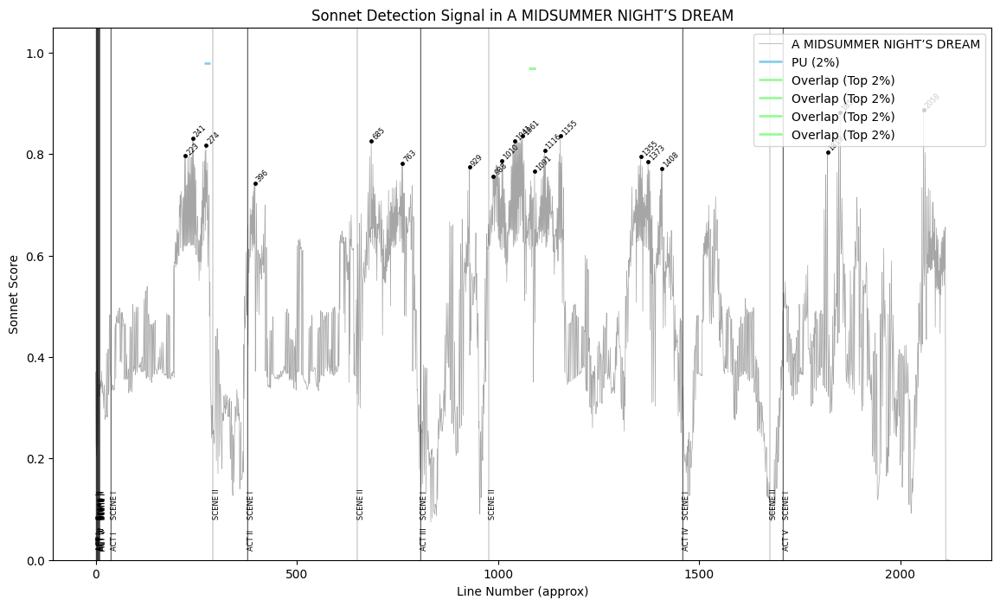

**Figure 17.** Wavelet power spectrum of the Midsummer signal

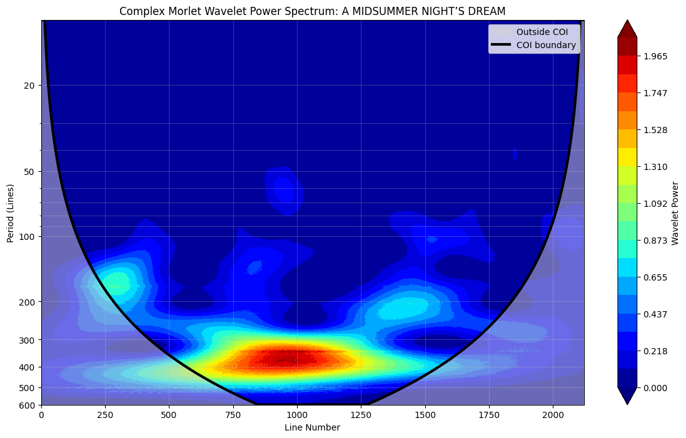

**Figure 18.** Wavelet power with significance contours

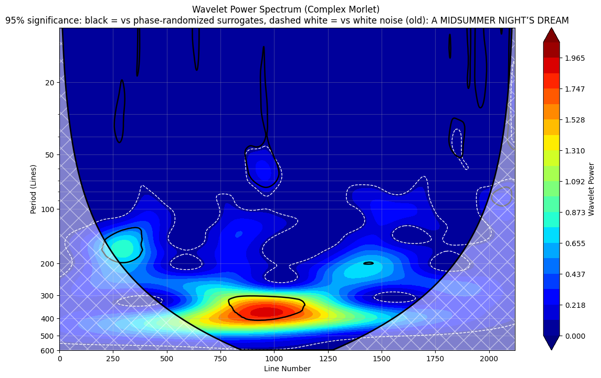

```text
Lag-1 autocorrelation of the score signal: 0.81  (0 = white noise, near 1 = strongly red)
Share of the spectrum (inside the cone of influence) called significant: white-noise test 66.5%, AR(1) red-noise test 45.5%, phase-randomized test 6.3%  (about 5% expected by chance)
Significant under the phase-randomized test = power concentrated at one place in the play, not just a red-noise signal.
```

```text
Total unique word types in A MIDSUMMER NIGHT’S DREAM: 3007

Lines in TEST_GROUP_POETIC: 280
Lines in TEST_GROUP_NORMAL: 1519

=== RARE-WORD PERCENTAGES (TOKEN-BASED) ===
TEST_GROUP_POETIC:  total tokens = 2242
  % of tokens with frequency 1–2:  16.90%
  % of tokens with frequency 1–3:  21.86%

TEST_GROUP_NORMAL:  total tokens = 11753
  % of tokens with frequency 1–2:  15.83%
  % of tokens with frequency 1–3:  19.79%

Comparison (Poetic minus Normal):
  Δ% (1–2):  1.07 percentage points
  Δ% (1–3):  2.06 percentage points

=== NAIVE T-TESTS (treat every line as independent; kept for comparison) ===

1-use words:
  Poetic lines:  mean=0.861, std=0.942, n=280
  Normal lines:  mean=0.803, std=0.931, n=1519
  Welch t-test: t = 0.952, p = 0.3418

1–2-use words:
  Poetic lines:  mean=1.354, std=1.164, n=280
  Normal lines:  mean=1.225, std=1.096, n=1519
  Welch t-test: t = 1.712, p = 0.08781

1–3-use words:
  Poetic lines:  mean=1.750, std=1.262, n=280
  Normal lines:  mean=1.531, std=1.192, n=1519
  Welch t-test: t = 2.687, p = 0.007523

=== WINDOW PERMUTATION TEST (unit = 14-line window) ===
   1-use words: top windows 10.969% rare tokens vs random windows 10.794% ± 1.062%  ->  p (two-sided) = 0.868
 1–2-use words: top windows 17.250% rare tokens vs random windows 16.342% ± 1.335%  ->  p (two-sided) = 0.502
 1–3-use words: top windows 22.167% rare tokens vs random windows 20.544% ± 1.358%  ->  p (two-sided) = 0.239
```

**Figure 19.** How often each word is used in Midsummer


**Figure 20.** Score distribution: Midsummer windows vs all sonnets

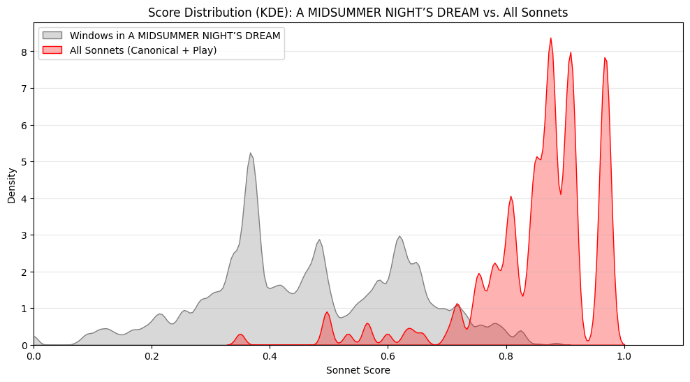

**Figure 21.** Fraction of word types by frequency: Sonnets vs Midsummer

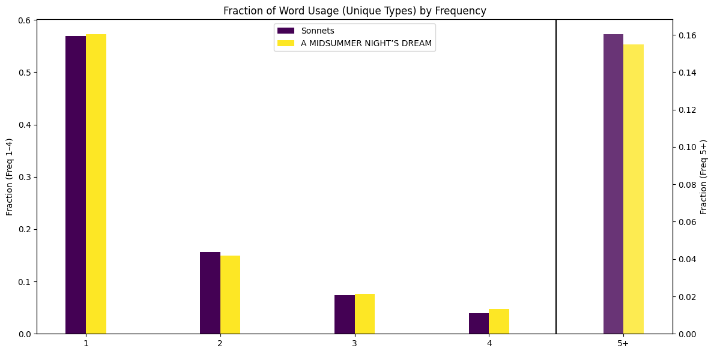

## Temporal analysis

```text
============================================================
TEMPORAL GROUP ANALYSIS
============================================================
  Date  Count  Avg Score  Avg Rhyme Div  Vocab Distinctness  Avg Noun Ratio  Avg Verb Ratio
1582.0      1   0.827738       2.000000            0.778876        0.231405        0.231405
1593.0     27   0.896653       1.481481            0.175491        0.255916        0.166210
1594.5     34   0.874984       1.352941            0.114979        0.247137        0.161115
1596.0     60   0.859231       1.516667            0.066229        0.272249        0.147085
1599.0      9   0.848056       1.777778            0.447735        0.214634        0.167458
1602.0     22   0.859131       1.272727            0.289303        0.240169        0.161078
```

**Figure 22.** Sonnets on PC1 vs PC2, coloured by composition date

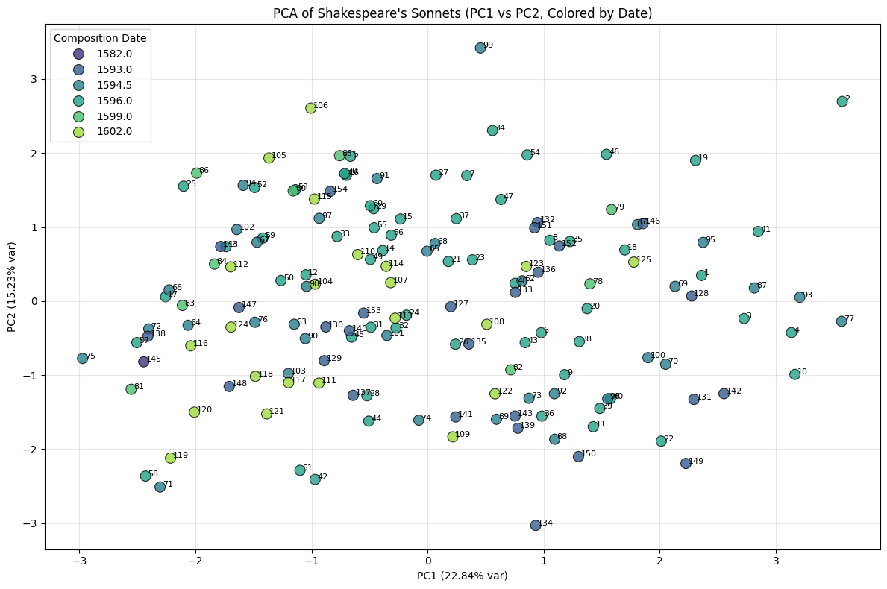

**Figure 23.** Feature loadings for PC1 and PC2

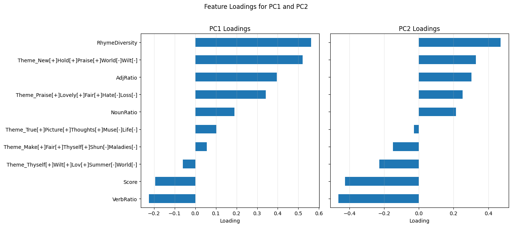

**Figure 24.** Sonnets on PC3 vs PC4, coloured by composition date

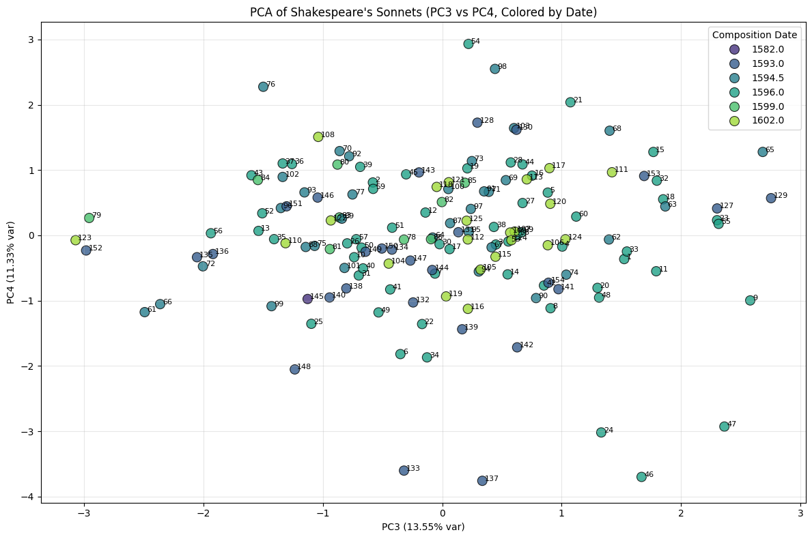

**Figure 25.** Feature loadings for PC3 and PC4

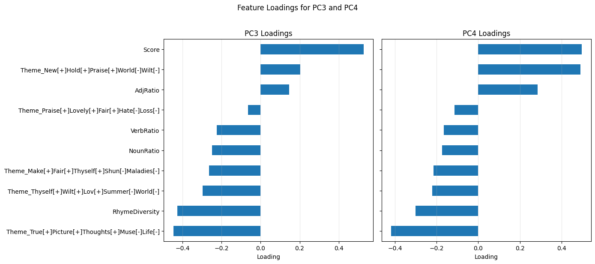

## Combined PCA

**Figure 26.** Combined PCA: temporal metrics, LSA themes and rare-word Ward clusters

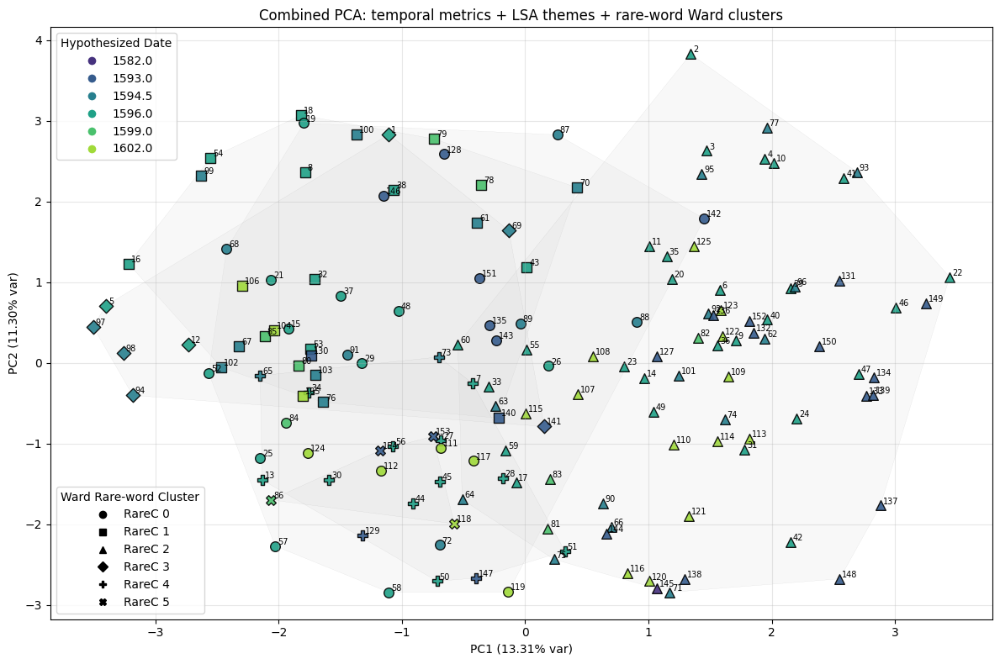

```text
======================================================================
CLUSTER CHARACTERIZATION (Agglomerative Ward on rare words)
======================================================================

--- Cluster 0 ---
Number of sonnets: 29
  Avg metrics: Score=0.876, RhymeDiversity=1.483, NounRatio=0.248, VerbRatio=0.154, AdjRatio=0.090
  Dominant themes: Theme_Make[+]Fair[+]Thyself[+]Shun[-]Maladies[-], Theme_Praise[+]Lovely[+]Fair[+]Hate[-]Loss[-], Theme_Thyself[+]Wilt[+]Lov[+]Summer[-]World[-]
  Top rare words: whom, whilst, rich, making, hours, within, mayst, prove, right, stay, glory, state, store, hope, any, great, earth, grows, happy, lived

--- Cluster 1 ---
Number of sonnets: 25
  Avg metrics: Score=0.841, RhymeDiversity=1.480, NounRatio=0.248, VerbRatio=0.147, AdjRatio=0.100
  Dominant themes: Theme_Make[+]Fair[+]Thyself[+]Shun[-]Maladies[-], Theme_Thyself[+]Wilt[+]Lov[+]Summer[-]World[-], Theme_New[+]Hold[+]Praise[+]World[-]Wilt[-]
  Top rare words: muse, pen, argument, write, had, pride, sing, long, lovely, lines, roses, invention, grace, speak, stand, ever, cheek, bear, buds, breath

--- Cluster 2 ---
Number of sonnets: 72
  Avg metrics: Score=0.875, RhymeDiversity=1.431, NounRatio=0.256, VerbRatio=0.165, AdjRatio=0.088
  Dominant themes: Theme_Make[+]Fair[+]Thyself[+]Shun[-]Maladies[-], Theme_New[+]Hold[+]Praise[+]World[-]Wilt[-], Theme_True[+]Picture[+]Thoughts[+]Muse[-]Life[-]
  Top rare words: take, mind, knows, could, shalt, place, leave, looks, lies, hate, friend, sun, full, although, we, wilt, die, ever, form, foul

--- Cluster 3 ---
Number of sonnets: 8
  Avg metrics: Score=0.889, RhymeDiversity=1.500, NounRatio=0.283, VerbRatio=0.147, AdjRatio=0.078
  Dominant themes: Theme_Make[+]Fair[+]Thyself[+]Shun[-]Maladies[-], Theme_Thyself[+]Wilt[+]Lov[+]Summer[-]World[-], Theme_Praise[+]Lovely[+]Fair[+]Hate[-]Loss[-]
  Top rare words: summer's, leaves, smell, summer, winter, die, only, bareness, been, base, view, due, desire, deeds, world's, birds, count, very, odour, grow

--- Cluster 4 ---
Number of sonnets: 15
  Avg metrics: Score=0.861, RhymeDiversity=1.467, NounRatio=0.260, VerbRatio=0.151, AdjRatio=0.089
  Dominant themes: Theme_Make[+]Fair[+]Thyself[+]Shun[-]Maladies[-], Theme_Praise[+]Lovely[+]Fair[+]Hate[-]Loss[-], Theme_Thyself[+]Wilt[+]Lov[+]Summer[-]World[-]
  Top rare words: woe, black, longer, none, way, sad, th', strong, again, bright, makes, past, end, joy, desire, death's, swift, return, weary, against

--- Cluster 5 ---
Number of sonnets: 4
  Avg metrics: Score=0.859, RhymeDiversity=1.500, NounRatio=0.269, VerbRatio=0.145, AdjRatio=0.085
  Dominant themes: Theme_Thyself[+]Wilt[+]Lov[+]Summer[-]World[-], Theme_Make[+]Fair[+]Thyself[+]Shun[-]Maladies[-], Theme_Praise[+]Lovely[+]Fair[+]Hate[-]Loss[-]
  Top rare words: grew, sick, brand, cure, fire, prove, found, fell, asleep, bath, heat, mistress', laid, diseased, healthful, thence, full, maladies, took, brought

(End of cluster characterization.)
```

## Word-usage chart

**Figure 27.** Fraction of word types by frequency: Sonnets and three plays


## Sonnet Finder V2 (neural mode)

```text
Top 10 Scoring Segments in THE TRAGEDY OF ROMEO AND JULIET (Neural Detector):
========================================

Rank 1 | Score: 0.9721 | Start Line: 700
--------------------
[ROMEO] If I profane with my unworthiest hand
This holy shrine, the gentle sin is this,
My lips, two blushing pilgrims, ready stand
To smooth that rough touch with a tender kiss.
[JULIET] Good pilgrim, you do wrong your hand too much,
Which mannerly devotion shows in this;
For saints have hands that pilgrims’ hands do touch,
And palm to palm is holy palmers’ kiss.
[ROMEO] Have not saints lips, and holy palmers too?
[JULIET] Ay, pilgrim, lips that they must use in prayer.
[ROMEO] O, then, dear saint, let lips do what hands do:
They pray, grant thou, lest faith turn to despair.
[JULIET] Saints do not move, though grant for prayers’ sake.
[ROMEO] Then move not while my prayer’s effect I take.

Rank 2 | Score: 0.9566 | Start Line: 757
--------------------
[CHORUS] Now old desire doth in his deathbed lie,
And young affection gapes to be his heir;
That fair for which love groan’d for and would die,
With tender Juliet match’d, is now not fair.
Now Romeo is belov’d, and loves again,
Alike bewitched by the charm of looks;
But to his foe suppos’d he must complain,
And she steal love’s sweet bait from fearful hooks:
Being held a foe, he may not have access
To breathe such vows as lovers use to swear;
And she as much in love, her means much less
To meet her new beloved anywhere.
But passion lends them power, time means, to meet,
Tempering extremities with extreme sweet.

Rank 3 | Score: 0.9026 | Start Line: 31
--------------------
[CHORUS] Two households, both alike in dignity,
In fair Verona, where we lay our scene,
From ancient grudge break to new mutiny,
Where civil blood makes civil hands unclean.
From forth the fatal loins of these two foes
A pair of star-cross’d lovers take their life;
Whose misadventur’d piteous overthrows
Doth with their death bury their parents’ strife.
The fearful passage of their death-mark’d love,
And the continuance of their parents’ rage,
Which, but their children’s end, nought could remove,
Is now the two hours’ traffic of our stage;
The which, if you with patient ears attend,
What here shall miss, our toil shall strive to mend.

Rank 4 | Score: 0.8282 | Start Line: 297
--------------------
[CAPULET] At my poor house look to behold this night
Earth-treading stars that make dark heaven light:
Such comfort as do lusty young men feel
When well apparell’d April on the heel
Of limping winter treads, even such delight
Among fresh female buds shall you this night
Inherit at my house. Hear all, all see,
And like her most whose merit most shall be:
Which, on more view of many, mine, being one,
May stand in number, though in reckoning none.
Come, go with me. Go, sirrah, trudge about
Through fair Verona; find those persons out
Whose names are written there,  and to them say,
My house and welcome on their pleasure stay.

Rank 5 | Score: 0.8230 | Start Line: 1015
--------------------
[ROMEO] Sleep dwell upon thine eyes, peace in thy breast.
Would I were sleep and peace, so sweet to rest.
Hence will I to my ghostly Sire’s cell,
His help to crave and my dear hap to tell.
[FRIAR LAWRENCE] The grey-ey’d morn smiles on the frowning night,
Chequering the eastern clouds with streaks of light;
And fleckled darkness like a drunkard reels
From forth day’s pathway, made by Titan’s fiery wheels
Now, ere the sun advance his burning eye,
The day to cheer, and night’s dank dew to dry,
I must upfill this osier cage of ours
With baleful weeds and precious-juiced flowers.
The earth that’s nature’s mother, is her tomb;
What is her burying grave, that is her womb:

Rank 6 | Score: 0.7814 | Start Line: 464
--------------------
[LADY CAPULET] This precious book of love, this unbound lover,
To beautify him, only lacks a cover:
The fish lives in the sea; and ’tis much pride
For fair without the fair within to hide.
That book in many’s eyes doth share the glory,
That in gold clasps locks in the golden story;
So shall you share all that he doth possess,
By having him, making yourself no less.
[NURSE] No less, nay bigger. Women grow by men.
[LADY CAPULET] Speak briefly, can you like of Paris’ love?
[JULIET] I’ll look to like, if looking liking move:
But no more deep will I endart mine eye
Than your consent gives strength to make it fly.
[SERVANT] Madam, the guests are come, supper served up, you called, my young lady

Rank 7 | Score: 0.7809 | Start Line: 1088
--------------------
[FRIAR LAWRENCE] Jesu Maria, what a deal of brine
Hath wash’d thy sallow cheeks for Rosaline!
How much salt water thrown away in waste,
To season love, that of it doth not taste.
The sun not yet thy sighs from heaven clears,
Thy old groans yet ring in mine ancient ears.
Lo here upon thy cheek the stain doth sit
Of an old tear that is not wash’d off yet.
If ere thou wast thyself, and these woes thine,
Thou and these woes were all for Rosaline,
And art thou chang’d? Pronounce this sentence then,
Women may fall, when there’s no strength in men.
[ROMEO] Thou chidd’st me oft for loving Rosaline.
[FRIAR LAWRENCE] For doting, not for loving, pupil mine.

Rank 8 | Score: 0.7757 | Start Line: 647
--------------------
[ROMEO] O, she doth teach the torches to burn bright!
It seems she hangs upon the cheek of night
As a rich jewel in an Ethiop’s ear;
Beauty too rich for use, for earth too dear!
So shows a snowy dove trooping with crows
As yonder lady o’er her fellows shows.
The measure done, I’ll watch her place of stand,
And touching hers, make blessed my rude hand.
Did my heart love till now? Forswear it, sight!
For I ne’er saw true beauty till this night.
[TYBALT] This by his voice, should be a Montague.
Fetch me my rapier, boy. What, dares the slave
Come hither, cover’d with an antic face,
To fleer and scorn at our solemnity?

Rank 9 | Score: 0.7660 | Start Line: 1060
--------------------
[FRIAR LAWRENCE] Or if not so, then here I hit it right,
Our Romeo hath not been in bed tonight.
[ROMEO] That last is true; the sweeter rest was mine.
[FRIAR LAWRENCE] God pardon sin. Wast thou with Rosaline?
[ROMEO] With Rosaline, my ghostly father? No.
I have forgot that name, and that name’s woe.
[FRIAR LAWRENCE] That’s my good son. But where hast thou been then?
[ROMEO] I’ll tell thee ere thou ask it me again.
I have been feasting with mine enemy,
Where on a sudden one hath wounded me
That’s by me wounded. Both our remedies
Within thy help and holy physic lies.
I bear no hatred, blessed man; for lo,
My intercession likewise steads my foe.

Rank 10 | Score: 0.7660 | Start Line: 1035
--------------------
[FRIAR LAWRENCE] For naught so vile that on the earth doth live
But to the earth some special good doth give;
Nor aught so good but, strain’d from that fair use,
Revolts from true birth, stumbling on abuse.
Virtue itself turns vice being misapplied,
And vice sometime’s by action dignified.
Within the infant rind of this weak flower
Poison hath residence, and medicine power:
For this, being smelt, with that part cheers each part;
Being tasted, slays all senses with the heart.
Two such opposed kings encamp them still
In man as well as herbs,—grace and rude will;
And where the worser is predominant,
Full soon the canker death eats up that plant.
```

**Figure 28.** Neural-mode detection signal in Romeo and Juliet

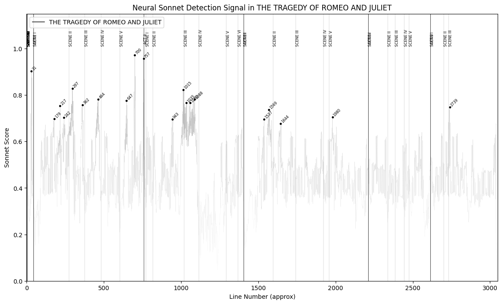

**Figure 29.** Neural-mode score distributions: Sonnets vs three plays

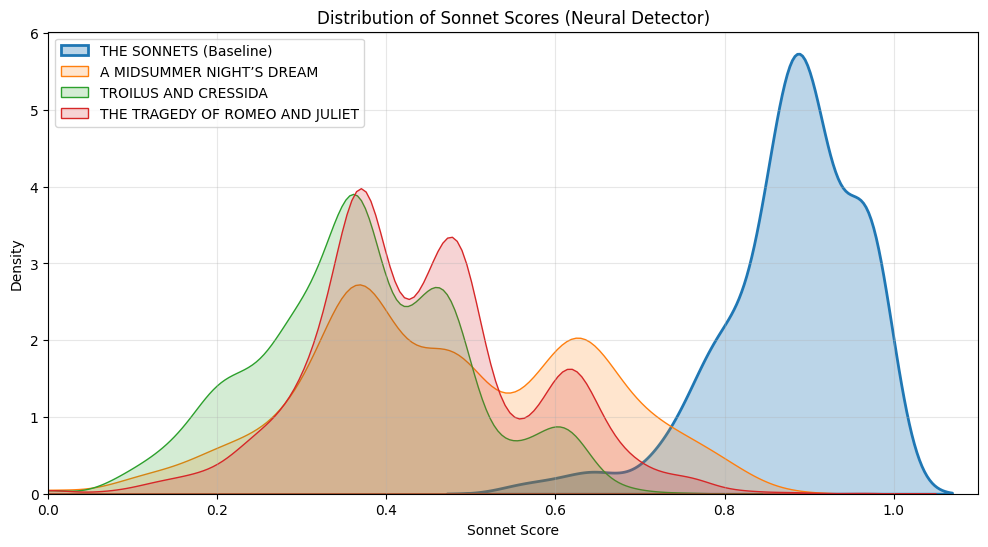

## Semantic coherence (validation)

```text
Random line pairs: raw cosine mean 0.15, centered cosine mean 0.00
(Centered values near 0 for unrelated lines are what we want.)


Validation: known play sonnets coherence 0.062 (median, n=21) vs random play windows 0.047 (n=60);  Mann-Whitney p = 0.0781
-> Coherence does NOT distinguish known sonnets from ordinary dialogue here; differences below should not be read as evidence.
Scoring 'THE SONNETS'...
Scoring 'A MIDSUMMER NIGHT’S DREAM'...
Analyzing A MIDSUMMER NIGHT’S DREAM...
Scoring 'TROILUS AND CRESSIDA'...
Analyzing TROILUS AND CRESSIDA...


                           count   mean    std    min    25%    50%    75%  \
Work                                                                         
A MIDSUMMER NIGHT’S DREAM   25.0  0.051  0.020 -0.006  0.043  0.050  0.059   
Known play sonnets          21.0  0.067  0.043  0.012  0.040  0.062  0.080   
Random play windows         60.0  0.050  0.029  0.007  0.031  0.047  0.059   
THE SONNETS                 40.0  0.077  0.026  0.032  0.056  0.078  0.086   
TROILUS AND CRESSIDA        25.0  0.050  0.025  0.018  0.036  0.046  0.056   

                             max  
Work                              
A MIDSUMMER NIGHT’S DREAM  0.108  
Known play sonnets         0.179  
Random play windows        0.139  
THE SONNETS                0.139  
TROILUS AND CRESSIDA       0.116  
```

**Figure 30.** Semantic coherence by group

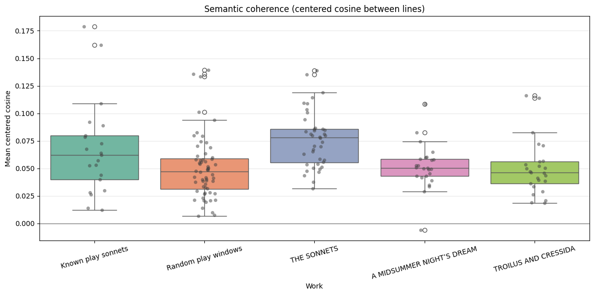

## Stylometry

**Figure 31.** Stylometry: PCA of top-100-word counts

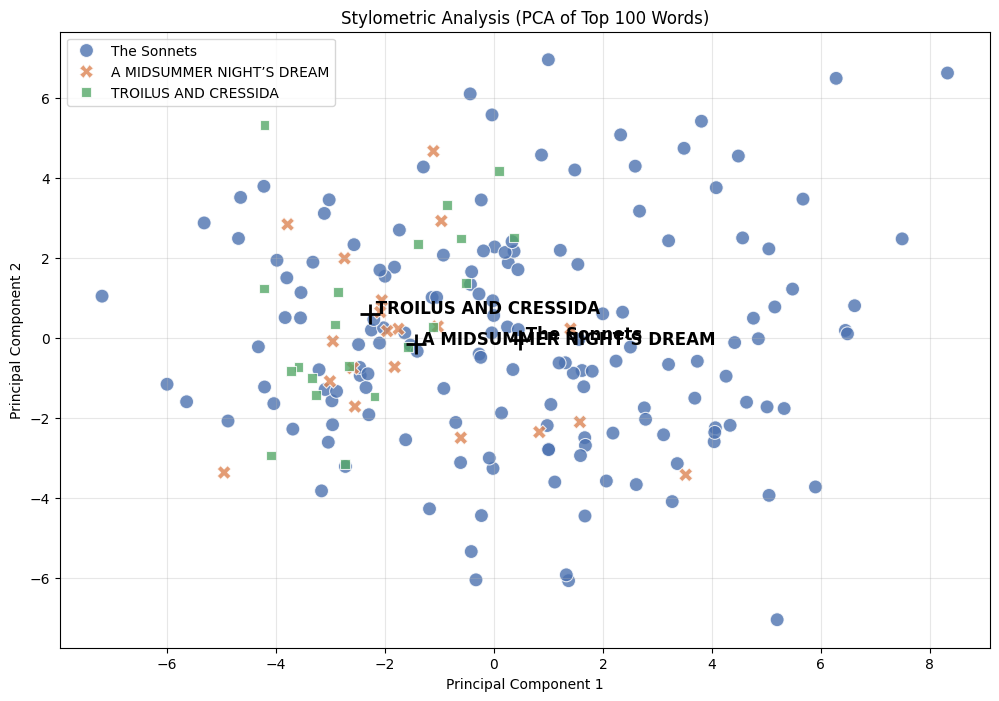

## Distinctness (validation)

```text
Validation Semantic_Dist: known sonnets median 0.868 vs random windows 0.792  (Mann-Whitney p = 0.00985)
Validation Style_Dist: known sonnets median 0.873 vs random windows 0.844  (Mann-Whitney p = 8e-05)
If p > 0.05, this measure can't tell a known sonnet from ordinary dialogue, so it can't confirm new candidates either.

Analyzing Contextual Distinctness for: THE TRAGEDY OF ROMEO AND JULIET
Analyzing THE TRAGEDY OF ROMEO AND JULIET...

Analyzing Contextual Distinctness for: A MIDSUMMER NIGHT’S DREAM
Analyzing A MIDSUMMER NIGHT’S DREAM...

Analyzing Contextual Distinctness for: THE TRAGEDY OF HAMLET, PRINCE OF DENMARK
Analyzing THE TRAGEDY OF HAMLET, PRINCE OF DENMARK...


                                    Work  Rank  Score  Semantic_Dist  Style_Dist                                                   Snippet
         THE TRAGEDY OF ROMEO AND JULIET     1  0.969          0.816       0.862                     If I profane with my unworthiest hand
         THE TRAGEDY OF ROMEO AND JULIET     2  0.954          0.642       0.873                  Now old desire doth in his deathbed lie,
         THE TRAGEDY OF ROMEO AND JULIET     3  0.902          0.768       0.908                    Two households, both alike in dignity,
         THE TRAGEDY OF ROMEO AND JULIET     4  0.826          0.807       0.881         Sleep dwell upon thine eyes, peace in thy breast.
         THE TRAGEDY OF ROMEO AND JULIET     5  0.826          0.847       0.829                At my poor house look to behold this night
         THE TRAGEDY OF ROMEO AND JULIET     6  0.781          0.727       0.870           This precious book of love, this unbound lover,
         THE TRAGEDY OF ROMEO AND JULIET     7  0.777          0.876       0.823             O, she doth teach the torches to burn bright!
         THE TRAGEDY OF ROMEO AND JULIET     8  0.766          0.808       0.873            For naught so vile that on the earth doth live
         THE TRAGEDY OF ROMEO AND JULIET     9  0.759          1.033       0.857                      When the devout religion of mine eye
         THE TRAGEDY OF ROMEO AND JULIET    10  0.754          0.597       0.833                           At thy good heart’s oppression.
               A MIDSUMMER NIGHT’S DREAM     1  0.888          0.667       0.878                            Now the wasted brands do glow,
               A MIDSUMMER NIGHT’S DREAM     2  0.882          0.607       0.776                 And as she fled, her mantle she did fall;
               A MIDSUMMER NIGHT’S DREAM     3  0.836          0.814       0.824                   So sorrow’s heaviness doth heavier grow
               A MIDSUMMER NIGHT’S DREAM     4  0.836          0.885       0.885         Dark night, that from the eye his function takes,
               A MIDSUMMER NIGHT’S DREAM     5  0.831          0.630       0.855               Take comfort: he no more shall see my face;
               A MIDSUMMER NIGHT’S DREAM     6  0.826          0.715       0.783          Fair love, you faint with wand’ring in the wood.
               A MIDSUMMER NIGHT’S DREAM     7  0.826          0.747       0.843               I had rather give his carcass to my hounds.
               A MIDSUMMER NIGHT’S DREAM     8  0.818          0.742       0.842          Love looks not with the eyes, but with the mind;
               A MIDSUMMER NIGHT’S DREAM     9  0.807          0.868       0.847                      Crystal is muddy. O how ripe in show
               A MIDSUMMER NIGHT’S DREAM    10  0.805          0.836       0.809                   If we offend, it is with our good will.
THE TRAGEDY OF HAMLET, PRINCE OF DENMARK     1  0.828          0.849       0.860                         But orderly to end where I begun,
THE TRAGEDY OF HAMLET, PRINCE OF DENMARK     2  0.720          0.888       0.842                  But, woe is me, you are so sick of late,
THE TRAGEDY OF HAMLET, PRINCE OF DENMARK     3  0.707          0.779       0.863         Which now, like fruit unripe, sticks on the tree,
THE TRAGEDY OF HAMLET, PRINCE OF DENMARK     4  0.659          0.747       0.806                  Or in th’incestuous pleasure of his bed,
THE TRAGEDY OF HAMLET, PRINCE OF DENMARK     5  0.642          0.620       0.812         And from his mother’s closet hath he dragg’d him.
THE TRAGEDY OF HAMLET, PRINCE OF DENMARK     6  0.631          0.955       0.895               And keep you in the rear of your affection,
THE TRAGEDY OF HAMLET, PRINCE OF DENMARK     7  0.631          0.734       0.821                     Of habits evil, is angel yet in this,
THE TRAGEDY OF HAMLET, PRINCE OF DENMARK     8  0.630          0.714       0.841           And England, if my love thou hold’st at aught,—
THE TRAGEDY OF HAMLET, PRINCE OF DENMARK     9  0.627          0.941       0.879 The courtier’s, soldier’s, scholar’s, eye, tongue, sword,
THE TRAGEDY OF HAMLET, PRINCE OF DENMARK    10  0.627          0.874       0.856              That have a father kill’d, a mother stain’d,
                      Known play sonnets     0    NaN          0.883       0.881            My thoughts do harbour with my Silvia nightly,
                      Known play sonnets     0    NaN          0.731       0.780                      But if that I am I, then well I know
                      Known play sonnets     0    NaN          0.724       0.856                     Study me how to please the eye indeed
                      Known play sonnets     0    NaN          0.840       0.820        Ay, that there is. Our court, you know, is haunted
                      Known play sonnets     0    NaN          0.935       0.923      If love make me forsworn, how shall I swear to love?
                      Known play sonnets     0    NaN          0.721       0.868                  So sweet a kiss the golden sun gives not
                      Known play sonnets     0    NaN          0.859       0.860               Did not the heavenly rhetoric of thine eye,
                      Known play sonnets     0    NaN          0.891       0.874                 O, never will I trust to speeches penned,
                      Known play sonnets     0    NaN          0.768       0.908                    Two households, both alike in dignity,
                      Known play sonnets     0    NaN          0.816       0.862                     If I profane with my unworthiest hand
                      Known play sonnets     0    NaN          0.642       0.873                  Now old desire doth in his deathbed lie,
                      Known play sonnets     0    NaN          0.821       0.856                   If we offend, it is with our good will.
                      Known play sonnets     0    NaN          0.932       0.872              What fire is in mine ears? Can this be true?
                      Known play sonnets     0    NaN          0.824       0.893                  Thus far, with rough and all-unable pen,
                      Known play sonnets     0    NaN          0.918       0.929              Hang there, my verse, in witness of my love.
                      Known play sonnets     0    NaN          1.007       0.910     Words, vows, gifts, tears, and love’s full sacrifice,
                      Known play sonnets     0    NaN          1.056       0.872                     Our remedies oft in ourselves do lie,
                      Known play sonnets     0    NaN          1.031       0.863                 I am Saint Jaques’ pilgrim, thither gone.
                      Known play sonnets     0    NaN          0.868       0.881                         Now sleep yslaked hath the rouse;
                      Known play sonnets     0    NaN          0.874       0.884            My temple stands in Ephesus: hie thee thither,
                      Known play sonnets     0    NaN          0.883       0.885                 No more, you petty spirits of region low,
```

**Figure 32.** Contextual distinctness of the top 10 candidates per play

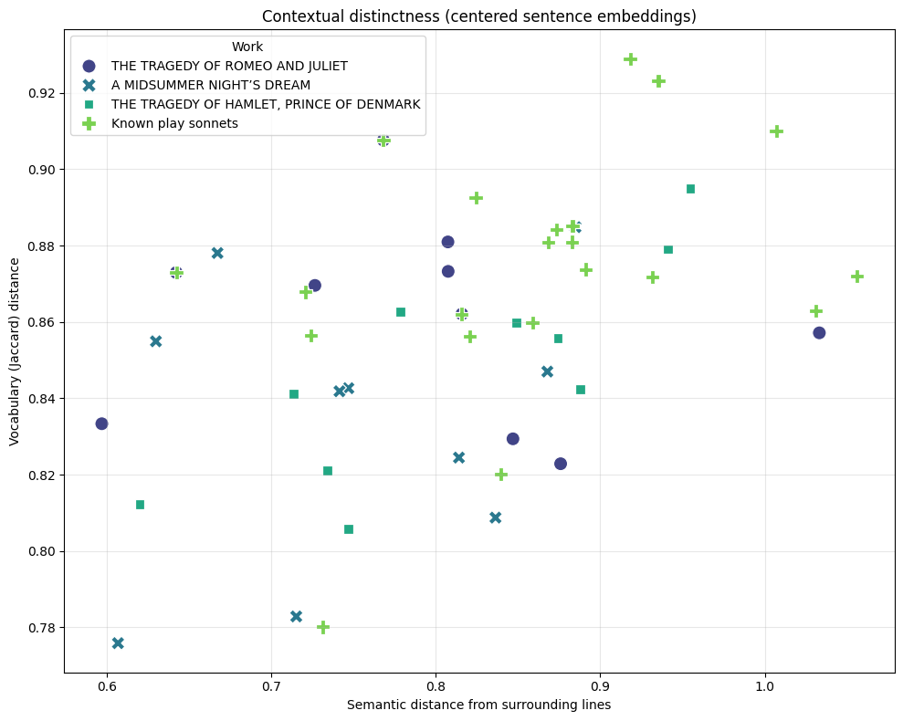

## Distinctness, top 20

```text
Detailed Distinctness Data:
                                    Work  Rank    Score  Semantic_Dist  Style_Dist                                                   Snippet
         THE TRAGEDY OF ROMEO AND JULIET     1 0.969464       0.815929    0.862069                     If I profane with my unworthiest hand
         THE TRAGEDY OF ROMEO AND JULIET     2 0.953750       0.642380    0.872928                  Now old desire doth in his deathbed lie,
         THE TRAGEDY OF ROMEO AND JULIET     3 0.901667       0.768240    0.907609                    Two households, both alike in dignity,
         THE TRAGEDY OF ROMEO AND JULIET     4 0.826071       0.807450    0.880952         Sleep dwell upon thine eyes, peace in thy breast.
         THE TRAGEDY OF ROMEO AND JULIET     5 0.825536       0.846970    0.829384                At my poor house look to behold this night
         THE TRAGEDY OF ROMEO AND JULIET     6 0.781364       0.726625    0.869565           This precious book of love, this unbound lover,
         THE TRAGEDY OF ROMEO AND JULIET     7 0.777250       0.875947    0.822857             O, she doth teach the torches to burn bright!
         THE TRAGEDY OF ROMEO AND JULIET     8 0.766000       0.807590    0.873239            For naught so vile that on the earth doth live
         THE TRAGEDY OF ROMEO AND JULIET     9 0.758812       1.033179    0.857143                      When the devout religion of mine eye
         THE TRAGEDY OF ROMEO AND JULIET    10 0.754318       0.597115    0.833333                           At thy good heart’s oppression.
         THE TRAGEDY OF ROMEO AND JULIET    11 0.751062       0.660022    0.828283           As signal that thou hear’st something approach.
         THE TRAGEDY OF ROMEO AND JULIET    12 0.748214       0.946300    0.861386              Care keeps his watch in every old man’s eye,
         THE TRAGEDY OF ROMEO AND JULIET    13 0.730000       0.611199    0.848168              So soon forsaken? Young men’s love then lies
         THE TRAGEDY OF ROMEO AND JULIET    14 0.718000       0.429046    0.841837               And to’t they go like lightning; for, ere I
         THE TRAGEDY OF ROMEO AND JULIET    15 0.698500       0.881010    0.854839                       So far from sounding and discovery,
         THE TRAGEDY OF ROMEO AND JULIET    16 0.697524       0.687211    0.795181            This bud of love, by summer’s ripening breath,
         THE TRAGEDY OF ROMEO AND JULIET    17 0.693000       0.498237    0.868132                  I charge thee in the Prince’s name obey.
         THE TRAGEDY OF ROMEO AND JULIET    18 0.689167       0.580757    0.844920                 I have more care to stay than will to go.
         THE TRAGEDY OF ROMEO AND JULIET    19 0.676125       0.598234    0.836066                 There shall no figure at such rate be set
         THE TRAGEDY OF ROMEO AND JULIET    20 0.675426       0.700132    0.867647                        And made Verona’s ancient citizens
               A MIDSUMMER NIGHT’S DREAM     1 0.887679       0.667410    0.878049                            Now the wasted brands do glow,
               A MIDSUMMER NIGHT’S DREAM     2 0.882000       0.606944    0.775862                 And as she fled, her mantle she did fall;
               A MIDSUMMER NIGHT’S DREAM     3 0.835714       0.814144    0.824468                   So sorrow’s heaviness doth heavier grow
               A MIDSUMMER NIGHT’S DREAM     4 0.835714       0.884960    0.884817         Dark night, that from the eye his function takes,
               A MIDSUMMER NIGHT’S DREAM     5 0.831071       0.630001    0.854922               Take comfort: he no more shall see my face;
               A MIDSUMMER NIGHT’S DREAM     6 0.826488       0.715295    0.782857          Fair love, you faint with wand’ring in the wood.
               A MIDSUMMER NIGHT’S DREAM     7 0.825536       0.746966    0.842640               I had rather give his carcass to my hounds.
               A MIDSUMMER NIGHT’S DREAM     8 0.818036       0.741547    0.841837          Love looks not with the eyes, but with the mind;
               A MIDSUMMER NIGHT’S DREAM     9 0.807202       0.867880    0.846995                      Crystal is muddy. O how ripe in show
               A MIDSUMMER NIGHT’S DREAM    10 0.804875       0.836366    0.808743                   If we offend, it is with our good will.
               A MIDSUMMER NIGHT’S DREAM    11 0.796607       0.779216    0.857143                More tuneable than lark to shepherd’s ear,
               A MIDSUMMER NIGHT’S DREAM    12 0.795000       0.704374    0.912037          Till o’er their brows death-counterfeiting sleep
               A MIDSUMMER NIGHT’S DREAM    13 0.786964       0.841664    0.844660                  When in that moment, so it came to pass,
               A MIDSUMMER NIGHT’S DREAM    14 0.786071       0.878084    0.906404            Troop home to churchyards. Damnèd spirits all,
               A MIDSUMMER NIGHT’S DREAM    15 0.782143       0.819234    0.842105                            Not Hermia, but Helena I love.
               A MIDSUMMER NIGHT’S DREAM    16 0.774500       0.764508    0.839378                     Out of this wood do not desire to go.
               A MIDSUMMER NIGHT’S DREAM    17 0.771500       0.861487    0.853261                The villain is much lighter-heel’d than I:
               A MIDSUMMER NIGHT’S DREAM    18 0.765774       0.873708    0.870270                          Shall we their fond pageant see?
               A MIDSUMMER NIGHT’S DREAM    19 0.757143       0.838778    0.883721                      Were met together to rehearse a play
               A MIDSUMMER NIGHT’S DREAM    20 0.742625       0.795404    0.883249                     For Oberon is passing fell and wrath,
THE TRAGEDY OF HAMLET, PRINCE OF DENMARK     1 0.827857       0.848875    0.859813                         But orderly to end where I begun,
THE TRAGEDY OF HAMLET, PRINCE OF DENMARK     2 0.719643       0.887960    0.842391                  But, woe is me, you are so sick of late,
THE TRAGEDY OF HAMLET, PRINCE OF DENMARK     3 0.707143       0.778540    0.862637         Which now, like fruit unripe, sticks on the tree,
THE TRAGEDY OF HAMLET, PRINCE OF DENMARK     4 0.659000       0.746736    0.805714                  Or in th’incestuous pleasure of his bed,
THE TRAGEDY OF HAMLET, PRINCE OF DENMARK     5 0.642489       0.620097    0.812183         And from his mother’s closet hath he dragg’d him.
THE TRAGEDY OF HAMLET, PRINCE OF DENMARK     6 0.630903       0.954779    0.895000               And keep you in the rear of your affection,
THE TRAGEDY OF HAMLET, PRINCE OF DENMARK     7 0.630774       0.733980    0.821053                     Of habits evil, is angel yet in this,
THE TRAGEDY OF HAMLET, PRINCE OF DENMARK     8 0.630449       0.713676    0.841176           And England, if my love thou hold’st at aught,—
THE TRAGEDY OF HAMLET, PRINCE OF DENMARK     9 0.627494       0.941298    0.879070 The courtier’s, soldier’s, scholar’s, eye, tongue, sword,
THE TRAGEDY OF HAMLET, PRINCE OF DENMARK    10 0.627313       0.874246    0.855769              That have a father kill’d, a mother stain’d,
THE TRAGEDY OF HAMLET, PRINCE OF DENMARK    11 0.624167       1.088435    0.895000                     That live and feed upon your Majesty.
THE TRAGEDY OF HAMLET, PRINCE OF DENMARK    12 0.620227       0.689958    0.836957               Seems, madam! Nay, it is; I know not seems.
THE TRAGEDY OF HAMLET, PRINCE OF DENMARK    13 0.617500       0.814635    0.832432               Play something like the murder of my father
THE TRAGEDY OF HAMLET, PRINCE OF DENMARK    14 0.615455       0.937577    0.854271                  What is the reason that you use me thus?
THE TRAGEDY OF HAMLET, PRINCE OF DENMARK    15 0.611190       0.922175    0.827160                 And bid me hold my peace. I pray you all,
THE TRAGEDY OF HAMLET, PRINCE OF DENMARK    16 0.607714       0.862662    0.838028             Which now to claim my vantage doth invite me.
THE TRAGEDY OF HAMLET, PRINCE OF DENMARK    17 0.605750       0.893443    0.865672                       I had forgot. ’Tis so concluded on.
THE TRAGEDY OF HAMLET, PRINCE OF DENMARK    18 0.605476       0.863284    0.844311                    But bear me stiffly up. Remember thee?
THE TRAGEDY OF HAMLET, PRINCE OF DENMARK    19 0.603128       0.863246    0.834254      Well said, old mole! Canst work i’ th’earth so fast?
THE TRAGEDY OF HAMLET, PRINCE OF DENMARK    20 0.599767       0.810084    0.875676         And botch the words up fit to their own thoughts,
```

**Figure 33.** Contextual distinctness of the top 20 candidates per play

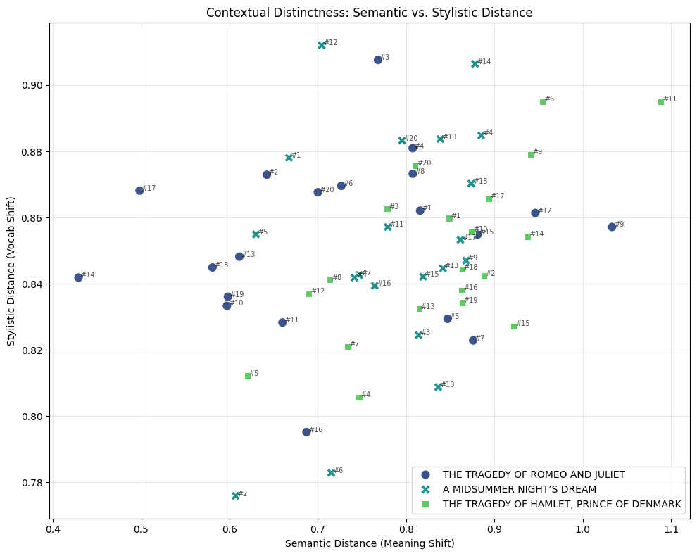
