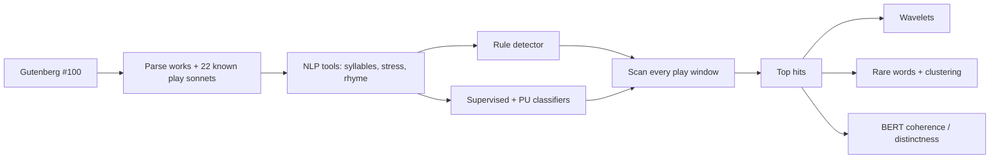

# Shakespeare Sonnet Hunter: Code Walkthrough & Improvements

Oct 9, 2026 · @Jian

## Overview

The notebook *Shakespeare's Hidden Sonnets* searches every 14-line window of Shakespeare's plays for passages that behave like sonnets. It scores 147,118 windows two ways: a hand-built rule score (meter, syllables, rhyme scheme, couplet) and two logistic-regression classifiers trained on the 154 canonical sonnets. It then studies the top hits with wavelets, rare-word statistics, clustering, PCA and BERT embeddings.

The idea and the ground-truth set are strong. The main problem is that nothing yet measures how well the detectors work. The rhyme check calls 29% of random word pairs a rhyme, so the rule score rewards almost any rhymed verse. Several cells also depend on variables that only exist if cells are run out of order.

All findings below come from reading the code and saved outputs, plus a re-run of the rhyme and syllable functions on your 22 play-sonnet passages.

## Pipeline at a glance



*Pipeline of the original notebook (version 4): 4 parts, 9 stages.*

Both detectors feed the same window scan, and every later analysis works on its top hits. The 22 known play sonnets are only plotted beside the canonical ones; nothing yet checks the scan against them.

## Walkthrough

The notebook has 43 cells in four parts. Cell numbers below are positions in the file (0-indexed), with your own "Cell N" labels in brackets.

| Cell | Part | What it does | Key output |
| --- | --- | --- | --- |
| 1 (Cell 1) | Setup | Installs `nltk`, `g2p_en`, `transformers`, `PyWavelets`; imports everything; loads the CMU Pronouncing Dictionary as `d` | `d`, \~123k word pronunciations |
| 4 (Cell 2) | 1 Intro | Downloads Project Gutenberg #100 and strips the header and footer | 5,359,397 characters |
| 6 (Cell 3) | 1 Intro | Splits the text into works by searching for each title; builds a synthetic "PLAY SONNETS" work of 22 known embedded sonnets, 11 typed in by hand | 45 works |
| 8 (Cell 4) | 1 Intro | Defines `count_syllables`, `get_rhyme_part` (stressed vowel to end of word), `get_stress_pattern` (0/1 per syllable) and `is_iambic` (match rate against 0101…) | Helper functions |
| 11 (Cell 5) | 2 Classifier | Re-implements the same helpers in a class and adds `StructuralFeatures`, an sklearn transformer giving rhyme density, syllable variance and mean iambic score | 3 features per passage |
| 13 (Cell 6) | 2 Classifier | Trains a supervised model (154 sonnets vs 154 random play blocks) and a PU model (sonnets vs 3,000 unlabeled windows); each is TF-IDF (100 terms) + structural features → logistic regression. Estimates the PU label frequency c | c = 0.981 |
| 15 (Cell 7) | 2 Classifier | Scores every window, keeps the top 2% of each model, takes the intersection, exports text and CSV, plots score distributions | 2,943 per model; 1,394 overlap |
| 19 (Cell 8) | 3 Hunter | `SonnetDetector`: rule score = meter 15% + syllables 15% + quatrain rhyme 40% + couplet 30%, with a small list of historical rhymes | `detector` |
| 21 (Cell 9) | 3 Hunter | Scans THE SONNETS with window sizes 10, 11, 14, 15 and 18; picks top hits with non-maximum suppression (NMS); classifies rhyme schemes; counts vocabulary; clusters sonnets by rare words (K-Means, Ward, Spectral) and compares the clusterings | ARI between methods −0.04 to 0.03 |
| 23 (Cell 10) | 3 Hunter | Same scan for one play (A Midsummer Night's Dream), overlays classifier hits, runs a complex Morlet wavelet transform, and t-tests rare-word rates in top hits vs the rest | Rare-word t-tests p = 0.47–0.78 |
| 24 | 3 Hunter | Temporal analysis: assigns each sonnet a composition date, extracts part-of-speech ratios and 5 LSA themes, runs PCA | PC plots by date |
| 27 (Cell 11) | 3 Hunter | Batch version of cell 23 over every work, saving signal and wavelet plots per play and zipping each batch | \~16 s per play |
| 29–31 | 3 Hunter | Hand-entered popularity numbers; a 5-work bar chart; re-downloads the candidate files | CSV of metrics |
| 34 | 4 Distinctness | `AdvancedSonnetDetector`: swaps CMU stress for a neural grapheme-to-phoneme model (G2P) on 14-line windows | Romeo and Juliet 1.5 ranks first |
| 36 | 4 Distinctness | BERT "semantic coherence" of top candidates vs real sonnets | Interrupted (KeyboardInterrupt) |
| 38 | 4 Distinctness | PCA of top-100-word counts for sonnets vs candidates | Stylometry scatter |
| 41–42 | 4 Distinctness | BERT distance between each candidate and the 14 lines either side, plus vocabulary Jaccard distance | Semantic distance 0.01–0.03 |

## What works well

- **A real ground-truth set.** The 22 play sonnets, with hand fixes where Gutenberg's layout breaks them, are the most valuable thing in the notebook. Few text-mining projects have labelled positives this clean.
- **Two independent detectors.** An interpretable rule score plus learned classifiers means a candidate has to satisfy both a formal definition and a statistical one.
- **PU learning is the right framing.** Play windows are unlabeled, not negative, since some are sonnets. Treating them as unlabeled is correct in principle.
- **Non-maximum suppression.** Overlapping windows would otherwise turn one sonnet into 14 adjacent "hits"; NMS collapses them.
- **Sanity checks.** Scoring a known negative (Friar Laurence's blank verse) and a known positive (the Romeo and Juliet prologue) is good practice.
- **Honest null results.** The rare-word t-tests (p ≈ 0.5–0.8) and near-zero clustering agreement are reported rather than hidden.
- **Wavelet care.** The cone of influence is computed and shaded, which many published analyses skip.

## Bugs to fix first

Each of these is confirmed from the code or saved outputs. The first two change the scores themselves; the rest break runs or results.

| # | Cell | Bug | Effect | Fix |
| --- | --- | --- | --- | --- |
| 1 | 19 | `check_rhyme` treats two words as rhyming if their last 2 letters match or their last vowel letter matches | 29% of random line-end pairs from your play sonnets count as rhymes, vs 1% with the CMU check alone; "love"/"time" rhymes | Drop the vowel-letter rule; keep CMU match + historical list; add a phonetic slant-rhyme rule (same final vowel phoneme) |
| 2 | 8, 11 | `re.findall(r"\w+")` splits on curly apostrophes, so "sister’s" → "sister", "s", and CMU reads "s" as a stressed syllable | Possessives and elisions (o’er, ’tis) add a false stressed beat; "To drown me in thy sister’s flood of tears" counts 11 syllables | Normalise ’ to ' and tokenise with `r"[A-Za-z']+"`; strip possessive 's before lookup |
| 3 | 19 vs 34 | Docstring says weights 25/15/35/25; `SonnetDetector` uses 15/15/40/30; `AdvancedSonnetDetector` uses 25/15/35/25 | The two detectors' scores are not comparable | Put weights in one `WEIGHTS` dict used by both |
| 4 | 11 | Empty-text branch appends 4 features; normal branch appends 3 | Would crash `np.array` if ever hit | Return `[0, 0, 0]` |
| 5 | 27 | `work_titles.insert(0, "THE SONNETS")` runs twice | THE SONNETS is analysed twice ("Split 46 works" from 45) | Delete the duplicate line |
| 6 | 23 vs 13 | Cell 23 drops speaker lines, headings and lines ≤ 10 characters before indexing; classifier windows in cell 13 keep them | Classifier overlay bars on the single-play plot point at the wrong lines | Use one shared `clean_play_lines()` for both; cell 27 already fixed this |
| 7 | 21 | Combined PCA reads `df_temporal`, which is only created in cell 24 | Silently skipped on a fresh run | Move the combined PCA after cell 24 |
| 8 | 30 | Uses `frac_mnd`, `frac_rj`, `frac_jc`, `frac_hp` (Harry Potter), defined nowhere | `NameError` on a fresh run | Restore the cell that builds them, or delete this cell |
| 9 | 31 | Writes the same filenames as cell 15 but only the first line of each window, titled "Top 5%" | Overwrites the full-text exports; label is wrong (threshold is 2%) | Delete cell 31; cell 15 already downloads |
| 10 | 42 | Appends to `all_results` without clearing it | Top-10 rows from cell 41 appear twice in the plot and table | Set `all_results = []` first |
| 11 | 36, 38 | Top candidates chosen with `np.argsort(scores)[-25:]`, no NMS; `idx + 14` can run past the end | Near-duplicate windows shifted by one line; possible `IndexError` | Reuse the NMS function and clip at `len(clean)` |

## Method improvements

### 1. Score the detectors against your 22 known play sonnets

This is the single biggest gain. You already know where 22 sonnets sit inside the plays, so you can measure recall: how many of them land in each detector's top-k after NMS. Without this, there is no way to tell whether a change helps.

```python
def recall_at_k(ranked_hits, known_spans, k=50, tol=3):
    """ranked_hits: [(play, start_line)] after NMS, best first.
    known_spans: [(play, start_line)] for the 22 play sonnets."""
    top = ranked_hits[:k]
    found = sum(any(p == kp and abs(s - ks) <= tol for p, s in top)
                for kp, ks in known_spans)
    return found / len(known_spans)

for k in (10, 50, 100, 500):
    print(k, recall_at_k(rule_hits, known_spans, k), recall_at_k(pu_hits, known_spans, k))
```

Record each known sonnet's start line in its own play once (the `find_sonnet_in_full_text` search already locates them). Then report recall@k and the median rank of the known sonnets for every detector. Tune weights and thresholds on half of the 22 and report on the other half, so you are not fitting to the test set.

### 2. Remove label leakage from the classifiers

Play windows contain speaker tags (ROMEO.), stage directions (\[*Exit.*\]) and act headings; the canonical sonnets never do. With TF-IDF in the model, the classifier can learn "no character names = sonnet" instead of anything about form. The Friar Laurence check hints at this: pasted without speaker tags, a passage of blank verse scored 0.79 on the supervised model, close to its 0.816 cut-off.

Strip tags and directions from every window before featurising, using the same cleaner in all cells. Then compare a structural-only model against structural + TF-IDF. If TF-IDF adds little after cleaning, drop it; the structural features are the scientific claim.

Evaluate on held-out data too. Both models are scored on the same sonnets they were trained on. Use `cross_val_predict` with `StratifiedKFold`, and report ROC-AUC on held-out folds.

### 3. Fix the PU estimate

The Elkan–Noto method divides by c = P(labeled | positive). It needs two things the code does not give it:

- **Calibrated probabilities.** `class_weight='balanced'` re-weights 154 positives against 3,000 unlabeled windows, which pushes positive scores up. That is likely why c = 0.981, which makes the correction almost a no-op.
- **c from held-out positives.** Estimating c on the training sonnets overstates it.

```python
from sklearn.model_selection import StratifiedKFold, cross_val_predict

pu = make_pipeline(...)  # same features, LogisticRegression WITHOUT class_weight
g = cross_val_predict(pu, X_pu, y_pu, cv=StratifiedKFold(5, shuffle=True, random_state=0),
                      method="predict_proba")[:, 1]
c = g[y_pu == 1].mean()          # held-out estimate
pu.fit(X_pu, y_pu)
p_scan = np.clip(pu.predict_proba(X_scan)[:, 1] / c, 0, 1)
```

PU learning also assumes labeled positives are a random sample of all positives. The 154 published sonnets are not a random sample of sonnets-in-plays: play sonnets are split between speakers and are often 10–18 lines. Say this in the write-up, and consider adding some play sonnets to the labeled set in cross-validation.

### 4. Tighten rhyme and meter

- **Rhyme.** After fixing bug 1, add a phonetic slant-rhyme level: same final stressed vowel phoneme, different coda. Score it at 0.5 instead of 1 so slant rhymes count but do not dominate.
- **Meter.** CMU gives most monosyllables primary stress, including "my", "do" and "with", so ordinary iambic lines score badly. Treat common function words as unstressed and allow the usual substitutions (trochaic first foot, feminine ending). Scoring the best alignment against the iambic template, rather than position-by-position matching, handles a missing or extra syllable without shifting every later position.
- **Rhyme weight.** Rhyme and couplet make up 70% of the rule score. Rhymed-couplet scenes therefore score like sonnets: the top Midsummer hit (0.93) is Hermia and Helena's AABB couplets. Once recall@k exists, tune the weights against it.

### 5. Use statistics that fit dependent data

- **Wavelet significance.** The score signal comes from overlapping windows, so neighbouring values are strongly correlated (red noise). A white-noise threshold will call many bands significant. Fit an AR(1) model to the signal and use its spectrum as the null, as in Torrence & Compo (1998).
- **Rare-word t-tests.** Lines inside one 14-line window are not independent. Compare per-window rates, or use a permutation test that shuffles whole windows.
- **Clustering.** ARI between K-Means, Ward and Spectral is −0.04 to 0.03, which is chance-level agreement. Treat that as the result: rare-word usage does not produce stable sonnet groups at k = 6. A silhouette score, or bootstrap stability across k, would make this explicit.

### 6. Use better sentence embeddings

The raw \[CLS\] vector of an un-fine-tuned BERT is a weak sentence embedding, and its cosine similarities cluster near 1. That is why every semantic distance in cells 41–42 falls between 0.01 and 0.03. Mean-pool the token embeddings, or use a sentence-embedding model, and embed whole passages rather than averaging line vectors. Early Modern English is also far from BERT's training text, so check the method on known cases (the 22 play sonnets vs their context) before reading meaning into differences.

## Speed and reproducibility

**Compute each line once.** With window sizes 10, 11, 14, 15 and 18, every line's stress pattern and end word is recomputed about 68 times. Precompute per-line features once, then score windows from those arrays. `lru_cache` is imported in cell 18 but never used; it is the quickest fix:

```python
from functools import lru_cache

@lru_cache(maxsize=None)
def stress_pattern(line):      # also wrap rhyme_part(word) and neural_g2p(line)
    return tuple(get_stress_pattern(line))
```

This should cut the \~16 s per play in cell 27 several-fold. It matters even more for the neural G2P in cell 34, which is far slower per call.

**Batch BERT.** Cells 36 and 41 run BERT one line at a time, which is why cell 36 was interrupted. Tokenise a list of passages with `padding=True` and run them as one batch; cache embeddings to disk with `np.save`.

**One copy of each helper.** `count_syllables` and `get_stress_pattern` exist twice, `analyze_work` three times with different line filtering, `get_sonnet_date` twice, and the sonnet-parsing loop four times. Move them to one cell (or a `.py` module) and import from there. Bugs 3 and 6 above come from these copies drifting apart.

**Restart and run all.** Execution counts are blank for most cells, and cells 21 and 30 only work with hidden state. Run Runtime > Restart and run all, then fix whatever breaks. Also pin package versions (`pip install nltk==3.9.1 …`) and drop `pip install --upgrade pip` and `pip cache purge`.

**Label hand-entered data.** The popularity numbers in cell 29 are estimates, and nothing downstream uses them. Either cite a source for each, or remove the cell.

## Suggested order of work

1. Consolidate the helper functions and the line cleaner into one cell, then Restart and run all until it passes.
2. Fix bugs 1–2 (rhyme heuristic, apostrophes), since they change every score downstream.
3. Build the recall@k evaluation on the 22 play sonnets and record a baseline for each detector.
4. Strip speaker tags and stage directions, add cross-validation, and fix the PU calibration. Re-measure recall.
5. Tune the rule weights and meter handling against recall, holding out half of the known sonnets.
6. Add caching and batching, then rerun the batch scan across all plays.
7. Only then revisit the wavelet, clustering and BERT analyses, with the statistical fixes above.

## Changes made in version 5

All 11 bugs and method improvements 1–4 are now in *Shakespeares\_Hidden\_Sonnets\_5\_revised.ipynb*, plus caching and two bugs found along the way. The wavelet, clustering and BERT rework (methods 5–6) are marked TODO in the code. The new rhyme rule credits 1.5% of random line-end pairs as full rhymes, down from 32%. The meter score on real verse lines rose from 0.62 to 0.87.

The Sonnet Hunter's purpose is to rank every passage in the plays by how sonnet-like it is, so the real sonnets rise to the top. Every change below serves one of three goals: score the form correctly, make every cell see the same text, or measure whether the ranking works.

How this was tested: Gutenberg is blocked from my workspace, so I could not rerun the full corpus. I tested the new scoring on real text saved in your notebook's outputs: the 22 play sonnets, 10 canonical sonnets, and 30 rhymed-couplet passages that the old detector ranked highest. I then ran every cell on a stand-in corpus built from those passages in Gutenberg's layout, with BERT and G2P replaced by fakes. That run only shows the cells execute; it says nothing about real accuracy. Recall numbers on the real corpus will come from your first Colab run (see First run results below).

| Check on real text | Old code | New code |
| --- | --- | --- |
| Random line-end pairs called a rhyme (n = 4,985) | 32.4% | 1.5% full, 11.6% weak |
| Rhyme positions in the play sonnets credited (n = 91) | 81% | 66% full, 78% full or weak |
| Verse lines counted at 10–11 syllables (n = 353) | 84% | 88% |
| Mean meter score on verse lines (0–1) | 0.62 | 0.87 |
| AUC, sonnets vs the old top couplet scenes | 0.62 | 0.71 |
| AUC, sonnets vs windows of shuffled verse lines | 0.94 | 0.96 |
| Time to scan 852 lines, all 5 window sizes | 1.29 s | 0.13 s |

AUC is the chance that a randomly picked real sonnet outscores a randomly picked non-sonnet (0.5 = coin flip, 1.0 = perfect). In this section, cell numbers are your own “Cell N” labels; unlabelled cells go by position in the original file (cell 34 = Sonnet Finder V2). Each subsection below gives four things: what the notebook did before, what was wrong, what the new code does, and why it matters for the hunter.

### 1. The shared toolkit (new cell 4)

**Before.** Cell 4 had one set of helpers. Cell 5 had a second copy inside `SonnetDetectorWrapper`, with a looser rhyme rule. `analyze_work` existed three times with different line filters, plus a fourth variant in cell 34. `get_sonnet_date` existed twice, and the sonnet-parsing loop four times. Each copy of NMS used a different radius (14 or 18 lines).

**Problem.** Copies drift apart. Bugs 3 and 6 were both drift: the two detectors used different weights, and two cells used different line filters. When the copies disagree, a score in one cell means something different from the same score in another.

**Now.** Cell 4 is now the single source for everything the later cells share: tokenising, pronunciation lookup, syllables, stress, meter, rhyme, `score_window`, `clean_play_lines`, `scan_work`, `analyze_work`, `nms_top_k`, `parse_sonnets_map`, `parse_play_sonnets` and `get_sonnet_date`. The old names still work, so the plotting code calls `analyze_work(title, lines)` as before. The lone `from functools import lru_cache` cell is gone, because the toolkit now imports and uses it.

**Why it matters for the hunter.** A candidate's rank now means the same thing everywhere. Fixing a rule once fixes it in every cell.

### 2. Tokenising: apostrophes and italics (bug 2, plus a new find)

**Before.** Every cell split lines with `re.findall(r"\w+", line)`.

**Problem.** Gutenberg uses curly apostrophes, which `\w+` treats as a break. So “sister’s” became “sister” + “s”, and CMU reads “s” as a stressed syllable. “To drown me in thy sister’s flood of tears” counted 11 syllables with a meter score of 0.45. A second problem turned up while testing: Gutenberg marks italics with underscores, and `\w+` counts `_` as a word. Several play sonnets are italicised because a character reads them aloud as a letter or poem (Love’s Labour’s Lost 4.2 and 4.3). Their last lines end like `tongue._` or `paradise?_`, so the detected end word was `_` and the couplet could never rhyme.

**Now.** `normalize_line` maps ’ to ' and drops underscores. `tokenize_words` keeps apostrophes inside words (o'er, 'tis, liv'st). Pronunciation lookup tries CMU, then a small Early Modern list (o'er, e'er, th', ta'en, eyne). It then tries the stem plus a consonant for elided endings: sister's, liv'st, lov'd. The example line now counts 10 syllables, with a meter score of 0.95. The rare-word cells use the same tokenizer, so stray “s” and “d” tokens no longer pad the vocabulary counts.

**Why it matters for the hunter.** Syllable count and meter make up 40% of the rule score. Miscounting every possessive and elision pushed real verse down the ranking.

### 3. Rhyme: graded levels replace letter matching (bug 1, method 4)

**Before.** `check_rhyme` returned True for any of four reasons: a hand-made historical pair; identical CMU rhyme parts; the same last two letters; or the same last vowel letter. Cell 5's classifier copy also accepted a match on the last phoneme alone.

**Problem.** The last two rules fire on chance. In a fresh sample of 4,985 random line-end pairs from your play sonnets, the old rule called 32% rhymes (your earlier sample gave 29%). “love”/“time” counted as a rhyme. Rhyme scheme and couplet together are 60–70% of the rule score. So any rhymed or even loosely rhymed verse looked like a sonnet, which is why the top Midsummer hits were Hermia and Helena’s couplets. The CMU comparison also kept stress digits, so “sanctify” (AY2) failed to rhyme with “hie” (AY1).

**Now.** `rhyme_level(w1, w2)` returns a grade instead of yes/no:

| Level | When |
| --- | --- |
| 1.0 | Same stressed vowel and everything after it, in any CMU pronunciation, stress digits ignored (scene/unclean, sanctify/hie) |
| 1.0 | A listed historical rhyme. The list grew from 9 pairs to 10 groups (love/prove/move/remove, wind/mind/kind, tongue/young/wrong, forth/worth, gone/upon, …) |
| 0.5 | Same final syllable in a word of 2+ syllables (dignity/mutiny, argument/punishment) |
| 0.5 | Early Modern “-y” against an “eye” sound (perjury/eye) |
| 0.5 | Same stressed vowel, different final consonants (slant rhyme) |
| 0.5 | The same word repeated |
| 0.5 | Word missing from CMU: last 3 letters match |
| 0 | Anything else |

Quatrains score the best of ABAB 1.0, ABBA 0.8, AABB 0.6, each multiplied by the weaker of its two rhyme pairs. A single cross pair scores 0.2. The old AAAA = 0.5 branch was removed: it could never run, because AAAA also matches AABB, which was checked first. The couplet score is the rhyme level of the last two lines. `check_rhyme` still exists for yes/no labels such as the ABAB/ABBA counts in cell 9 and the temporal-analysis cell; it means level 1.0.

**Why it matters for the hunter.** Rhyme is the main feature separating a sonnet from blank verse, so it has to be specific. Only 1.5% of random pairs now get full credit, against 66% of expected rhyme positions in the play sonnets. Most of the misses are passages that aren't Shakespearean in scheme, such as the tetrameter couplets in Pericles 10.

### 4. Meter: alignment against iambic templates (method 4)

**Before.** `get_stress_pattern` took CMU’s first pronunciation, which marks almost every one-syllable word as stressed. Unknown words got all-stressed syllables. `is_iambic` compared the pattern position by position with 0101…, and returned 0 below 8 or above 12 syllables.

**Problem.** Ordinary pentameter like “My love to thee is sound” scored badly because “my”, “to” and “is” read as stressed. Position-by-position matching also means one extra or missing syllable shifts every later position, so a single elision ruined the whole line. The mean meter score on verse lines from real sonnets was 0.62.

**Now.** Each syllable is tagged (stress, flexible). One-syllable function words (the, my, to, is, thou, hath, …) are unstressed. Other one-syllable words are stressed. Both are flexible, so a misplaced one costs 0.5 instead of 1. In longer words, primary stress is a fixed 1 and secondary stress is flexible. `meter_score` aligns the line to four templates and keeps the best: plain pentameter, a trochaic first foot, a feminine ending, or both. The alignment is an edit distance, so a missing or extra syllable costs 1 and shifts nothing else. Score = 1 − cost / 10. The syllable score still gives 1.0 for 10 syllables, or 11 with an unstressed ending, minus 0.1 per syllable off.

**Why it matters for the hunter.** Mean meter on real verse lines went from 0.62 to 0.87. Meter now separates verse from prose instead of adding noise. Note that it cannot separate a sonnet from blank verse, since both are iambic. That job falls to rhyme.

### 5. One scorer, one set of weights (bug 3, cells 8 and 34)

**Before.** The docstring in cell 8 promised weights of 25/15/35/25. `SonnetDetector` used 15/15/40/30. `AdvancedSonnetDetector` (cell 34) used 25/15/35/25, accepted only 14-line windows, and ran the neural G2P model on every line.

**Problem.** The two detectors’ scores could not be compared, and the docstring misdescribed the main detector. The neural detector was also slower than it needed to be. `g2p_en` looks every word up in CMU first and only predicts words CMU lacks. So running it on whole lines mostly re-derived CMU stresses, at neural-model speed.

**Now.** `WEIGHTS = {meter 0.25, syllable 0.15, rhyme 0.35, couplet 0.25}` lives in cell 4. `window_parts` returns the four component scores, and `score_window` multiplies them by `WEIGHTS`. `SonnetDetector` is now a thin wrapper, so old calls like `detector.score_window(lines)` still work. It also has a new `score_parts` method that shows why a passage scored as it did. The neural detector is `SonnetDetector(mode="g2p")`: the same scorer, weights and window sizes, with neural G2P used only for words CMU doesn’t know. The docstring now describes the code as it is.

**Why it matters for the hunter.** Rule and neural scores are now on one scale, so you can put them side by side. Weights are also no longer a judgment call. The evaluation cell (section 8) can tune them and tell you whether the change helps.

### 6. One line cleaner (bug 6, method 2, and a new bug)

**Before.** The cell 6 classifier windows used every non-blank line, including speaker tags (ROMEO.), stage directions and act headings. Cell 10 dropped speaker tags, headings and lines of 10 characters or fewer. Cell 11 kept everything, to match the classifier. The PU unlabeled pool and the cell 7 scan also included the synthetic PLAY SONNETS work.

**Problem.** There were three. First, line *i* meant a different line in different cells, so the classifier overlay bars on the single-play plot pointed at the wrong text. Second, label leakage: positives never contain speaker names or directions, but play windows almost always do. A model with TF-IDF can then learn “no character names = sonnet” instead of anything about form. Third (new): PLAY SONNETS is a copy of passages already in the plays, so including it duplicated those passages in the training pool and in the scan results.

**Now.** `clean_play_lines` is the one cleaner used by every scan, classifier window, plot and evaluation. It removes:

- blank lines and ACT / SCENE / PROLOGUE / EPILOGUE headings (recorded as plot boundaries)
- speaker tags (all-caps lines ending in a period), with the current speaker kept alongside each line
- stage directions: lines starting with \[ or with Enter, Exit, Exeunt, Re-enter, Flourish, Alarum, Sennet, Music or Thunder, plus inline \[…\] asides
- italic underscores, all-caps titles and sonnet numbers

Short lines are kept, so a shared or half line still counts as verse. The canonical sonnets go through the same cleaner, so both classes are treated alike. `NON_PLAY_TITLES` now includes PLAY SONNETS.

**Why it matters for the hunter.** Line indexes agree across cells, so the classifier overlay bars now line up with the text they mark. The classifiers can now only win on form, which is the scientific claim. The rule and classifier rankings also cover the same text, so they can be compared.

### 7. Classifiers: held-out scores, a TF-IDF test, PU calibration (methods 2–3)

**Before.** Both models were fit once and judged on the data they were trained on. Both used `class_weight='balanced'`. The PU label frequency c was the mean predicted probability on the training sonnets: 0.981. The cell 7 plot compared play windows with in-sample sonnet scores. PU scores were divided by c without clipping.

**Problem.** In-sample scores make any model look better than it is. Elkan–Noto PU learning needs g(x) = P(labeled | x) to be a calibrated probability. Balanced weighting of 154 positives against 3,000 unlabeled windows inflates positive scores. Measuring c on training sonnets inflates it further. With c ≈ 0.98, dividing by c changes almost nothing, so the PU model was effectively a plain classifier. Dividing by a smaller, correct c can also push values above 1.

**Now.**

- **Cross-validation.** 5-fold stratified CV (`cross_val_predict`) gives held-out probabilities and ROC-AUC for every model.
- **TF-IDF test.** The supervised model is scored twice, structural features only and structural + TF-IDF. `USE_TFIDF` turns on only if TF-IDF adds at least 0.01 held-out AUC; you can override it. The structural features are the scientific claim, so TF-IDF has to earn its place.
- **PU calibration.** The PU model trains without `class_weight`. c is the mean held-out probability on the labeled sonnets, and `pu_probability()` returns g(x)/c clipped to \[0, 1\]. The cell prints the new c next to the old 0.981.
- **Honest plots.** The cell 7 histogram plots held-out sonnet scores.
- **Feature fix.** `StructuralFeatures` uses the shared toolkit, so its rhyme feature is the graded `rhyme_level` summed over pairs. It returns 3 features on empty input too (bug 4).
- **Assumption flagged.** A printed caveat says PU assumes labeled sonnets are a random sample of all sonnets. Play sonnets are not (10–18 lines, often split between speakers), so treat PU outputs as a ranking.

**Why it matters for the hunter.** The classifiers are the second, independent opinion on each candidate. Held-out AUC says how much to trust that opinion. A working PU correction is what makes “unlabeled, not negative” (the right framing for a play that may hide sonnets) more than a label.

### 8. New evaluation cell: recall on the known play sonnets (method 1)

**Before.** Nothing measured whether any detector finds sonnets in plays. The 22 play sonnets were only plotted beside the canonical ones.

**Problem.** Without a number, there is no way to tell whether a change, such as new weights or a new rhyme rule, helps or hurts. This was the single biggest gap.

**Now.** A new cell, *Evaluate the Detectors on the 22 Known Play Sonnets*, sits after cell 8:

1. `locate_known_sonnets` finds each known sonnet’s first line in the cleaned lines of its play. Edward III is not in Gutenberg #100, so it is reported as unrecallable, leaving at most 21.
2. Those sonnets are split once, with a fixed seed, into a **tune** half and a **test** half.
3. Each detector’s scores go through the shared NMS in every play. All peaks are then pooled into one ranked list.
4. A hit matches a known sonnet if it starts within 3 lines of it. For 15–18-line passages the window is wider (n − 12 lines), because their best window can start a few lines in.
5. The cell reports **recall@k** (k = 10, 25, 50, 100, 250) and **median rank** for the rule detector, the supervised classifier and the PU classifier, on each half. It also prints a per-sonnet rank table.
6. `tune_weights()` grid-searches the four weights in steps of 0.1, choosing on the tune half only, and prints before → after on the test half. Re-weighting needs no re-scan (section 9), so the search takes about a minute.

**Why it matters for the hunter.** This turns “the top hits look sonnet-like” into “the detector finds X of 11 held-out sonnets in its top 50”. That is the claim the project needs to make, and every later analysis rests on it.

### 9. Speed: compute each line once (speed section)

**Before.** `analyze_work` called `score_window` for every start line and every window size (10, 11, 14, 15, 18). Each call re-tokenised every line, looked up every word and recomputed stress, so each line was processed about 68 times. Cell 11 took about 16 s per play. BERT ran one line per forward pass, which is why cell 36 was interrupted.

**Problem.** Slow runs discourage re-running, and re-running is what the evaluation loop needs.

**Now.**

- **Cached lookups.** `lru_cache` wraps pronunciation lookup, word stress, line stress, `line_features` and `rhyme_level`.
- **Fast scan.** `scan_work` computes each line’s meter, syllable score and end word once. It scores each 4-line quatrain and each 2-line couplet once per start line, then builds every window from those pieces with running sums. A check on every window of an 845-line test text matched `window_parts` to within 3 × 10⁻¹⁴. That text took 0.13 s, against 1.29 s for the old loop.
- **Re-weighting without re-scanning.** Scans store the four component scores per window and are cached per play. A new set of weights is a dot product, and cells 9, 10, 11, 36, 38 and the evaluation cell reuse one scan.
- **Batched BERT.** Cells 36 and 41 embed lines in batches of 64 and cache each line’s vector. The embedding itself is still raw \[CLS\] (see TODOs).

**Why it matters for the hunter.** A full rescan plus weight tuning is now minutes, not an afternoon, so you can afford to iterate against recall.

### 10. The remaining bugs

These are the smaller confirmed bugs from the table above, plus housekeeping. Each one either crashed a fresh run or quietly distorted a result.

| Bug | Before | Problem | Now | Why it matters |
| --- | --- | --- | --- | --- |
| 4 | Empty text gave 4 features; normal text gave 3 | `np.array` would fail on mixed lengths | Both paths return 3 | A blank window can’t crash training |
| 5 | `work_titles.insert(0, "THE SONNETS")` ran twice | THE SONNETS was analysed twice (“46 works” from 45) | Duplicate line removed | Batch output and timing are correct |
| 7 | Combined PCA in cell 9 read `df_temporal`, which only a later cell creates | Silently skipped on a fresh run | Moved to its own cell after the temporal analysis | The figure appears on Restart and run all |
| 8 | Cell 30 plotted `frac_mnd`, `frac_rj`, `frac_jc`, `frac_hp`, defined nowhere | `NameError` on a fresh run | Fractions computed in the cell from cleaned text; works missing from the corpus are skipped; Harry Potter dropped (no text in the notebook); chart takes any number of works | Cell runs, and every bar has a traceable source |
| 9 | Cell 31 rewrote cell 7’s files with first lines only, titled “Top 5%” | Full-text exports overwritten; wrong label (cut-off is 2%) | Cell 31 deleted; cell 7 already exports full text | Candidate files hold whole passages |
| 10 | Cell 42 appended to `all_results` without clearing it | Cell 41’s rows plotted twice | `all_results = []` first | Distinctness plot shows each candidate once |
| 11 | Cells 36 and 38 took `np.argsort(scores)[-25:]`, no NMS, and read `idx + 14` lines | Near-duplicate windows; possible `IndexError` at the end of a play | Shared `nms_top_k`, and `window_lines` clips at the end | Coherence and stylometry compare distinct passages |
| — | `!pip install --upgrade pip`, `!pip cache purge`, unpinned installs | Runs not reproducible | Pinned `nltk==3.9.1`, `g2p_en==2.1.0`, `PyWavelets==1.9.0`; versions of preinstalled torch, transformers and sklearn printed | A rerun months later gives the same numbers |
| — | `from google.colab import files` at top level | Notebook fails outside Colab | Wrapped in try/except | Runs locally too |
| — | `plt.cm.get_cmap` in two charts | Removed in Matplotlib 3.11 | `plt.get_cmap` | Charts survive the next Colab upgrade |
| — | Hand-entered popularity numbers in cell 12 | Look like data, have no source | Labelled as estimates in the cell, with a note to cite or remove | Nobody mistakes them for measurements |

### 11. Judgment calls

Judgment calls I made that you may want to revisit:

- A repeated end word (Edward III’s nine “sun”s) counts as a weak rhyme (0.5), not a full one. Repetition is rhyme-like, but rewarding it fully favours list-like speeches.
- The cleaner no longer drops lines of 10 characters or fewer. That filter removed short shared lines inside dialogue sonnets.
- The rhyme-density feature is now divided by 7 (the number of rhyme pairs in a Shakespearean sonnet) instead of 20. Because a scaler follows, this changes nothing in the model.

## First run results

The first full Colab run of version 5 finished with no errors, and it is the first evidence that the hunter finds what it looks for. The rule detector placed all 8 held-out known play sonnets in its top 250 and 5 of 8 in its top 50. The classifiers did far worse, and a cleaner bug hid 6 known sonnets from the test (see Bugs found in the first run). Numbers below come from the notebook’s saved output.

### Scoreboard

The evaluation cell located 15 of the 22 known play sonnets. Each half of the split therefore has only 7 or 8 sonnets, so one sonnet moves recall by 12–14 points.

| Detector | Half | n | Recall@10 | Recall@50 | Recall@250 | Median rank |
| --- | --- | --- | --- | --- | --- | --- |
| Rule detector | tune | 7 | 0.29 | 0.71 | 0.71 | 40 |
| Rule detector | test | 8 | 0.38 | 0.62 | 1.00 | 28 |
| Supervised classifier | tune | 7 | 0.00 | 0.14 | 0.29 | never |
| Supervised classifier | test | 8 | 0.00 | 0.12 | 0.12 | 492 |
| PU classifier | tune | 7 | 0.00 | 0.14 | 0.43 | 618 |
| PU classifier | test | 8 | 0.00 | 0.00 | 0.12 | 548 |

The rule detector ranked the Comedy of Errors sonnet 1st, Love’s Labour’s Lost 1.1.80 2nd, the R&J Act 2 Chorus 3rd and the R&J Prologue 5th. It never reached Love’s Labour’s Lost 4.3.57 or Cymbeline 5.5.187. Weight tuning on the tune half chose meter 0.4, syllable 0, rhyme 0.3, couplet 0.3, but the test half did not move (recall@50 0.62, median rank 28).

| Classifier check | Result |
| --- | --- |
| Held-out AUC, structural only | 0.976 |
| Held-out AUC, structural + TF-IDF | 0.978, so TF-IDF was switched off |
| PU held-out AUC / c | 0.977 / 0.411 (in-sample estimate was 0.981) |
| Clean play windows scanned | 106,420 |
| Windows in each top-2% list | 2,129 |
| Overlap of the two lists | 1,807 |
| Friar Laurence blank verse, supervised score | 0.06 (was 0.79) |

### What the hunter found

Midsummer’s new top hit (0.89) is Puck’s “Now the wasted brands do glow”: glow/loud/woe/shroud, night/wide/sprite/glide, run/team/sun/dream, then mouse/house. That is a full ABAB CDCD EFEF GG Shakespearean rhyme scheme in 14 lines, written in tetrameter. The old top hit, Hermia and Helena’s couplets, fell to 5th. In R&J the neural detector ranked the Act 2 Chorus (0.96) and the Prologue (0.90) first and second. In THE SONNETS the top window scored 0.98 (Sonnet 111).

### What stayed null

- **Clustering:** agreement between K-Means, Ward and Spectral (ARI) was −0.02 to 0.02, chance level.
- **Semantic distinctness:** every candidate scored 0.01–0.03, the same narrow band as before.
- **Midsummer rare words:** the per-line t-tests gave p = 0.40, 0.09 and 0.01 for words used once, 1–2 and 1–3 times. Only the last crosses 0.05, and it treats 280 lines as independent.
- **Rhyme-scheme labels:** Sonnet 1 was labelled “Irregular”.

## Walkthrough (version 5)

Version 5 has 45 cells in the same four parts, plus a shared toolkit and an evaluation cell. Cell names are your “Cell N” labels; unlabelled cells go by their title.

| Cell | Part | What it does | First-run output |
| --- | --- | --- | --- |
| 1 Setup | Setup | Pinned installs, imports, prints package versions | nltk 3.9.1, PyWavelets 1.9.0 |
| 2 | 1 Intro | Downloads Project Gutenberg #100 | 5,359,397 characters |
| 3 | 1 Intro | Splits works; builds PLAY SONNETS from the 22 known passages | 45 works |
| 4 Shared toolkit | 1 Intro | One copy of tokenising, syllables, stress, rhyme levels, `score_window`, `clean_play_lines`, `scan_work`, NMS | Weights 25/15/35/25 |
| 5 | 2 Classifier | `StructuralFeatures` from the toolkit: rhyme density, syllable variance, meter | 3 features |
| 6 | 2 Classifier | Cross-validated supervised and PU models on cleaned windows | AUC 0.976–0.978; TF-IDF off; c = 0.411 |
| 7 | 2 Classifier | Scores every clean window, exports top 2% lists and CSV | 2,129 per list; 1,807 overlap |
| 8 | 3 Hunter | Thin `SonnetDetector` wrapper over the toolkit | — |
| 8b Evaluation | 3 Hunter | Locates known sonnets, recall@k per detector, weight tuning | 15 of 22 located |
| 9 | 3 Hunter | THE SONNETS scan, rhyme schemes, vocabulary, rare-word clustering | Top window 0.98; ARI −0.02 to 0.02 |
| 10 | 3 Hunter | One play (Midsummer): signal, classifier overlay, wavelet, rare words | Top hit Puck 0.89; t-test p = 0.01 |
| Temporal analysis | 3 Hunter | Sonnet dates, part-of-speech ratios, LSA themes, PCA | 5 themes |
| Combined PCA | 3 Hunter | Moved after the temporal cell so it runs on a fresh run | Ran |
| 11 | 3 Hunter | Batch scan and plots for every work | 45 works in 6 batches |
| 12 | 3 Hunter | Hand-entered popularity numbers, labelled as estimates | Table |
| Word-usage chart | 3 Hunter | Rare-word fractions for Sonnets and three plays | Chart |
| Sonnet Finder V2 | 4 Distinctness | Same scorer with neural G2P for unknown words | R&J Chorus 0.96, Prologue 0.90 |
| Semantic Coherence | 4 Distinctness | Batched BERT \[CLS\] coherence, top 25 NMS candidates | Ran |
| Stylometry | 4 Distinctness | PCA of top-100-word counts | Ran |
| Distinctness (2 cells) | 4 Distinctness | BERT distance and Jaccard distance from surrounding lines | Semantic distance 0.01–0.03 |

## What works well (version 5)

- **The rule detector finds known sonnets.** All 8 held-out play sonnets landed in its top 250 of thousands of candidates, and the Comedy of Errors sonnet ranked 1st. This is the result the project needed.
- **The leakage fix worked.** The Friar Laurence blank verse fell from 0.79 to 0.06 on the supervised model once speaker tags and stage directions were removed from training windows.
- **The new rhyme rule rewards scheme, not just rhyme.** Hermia and Helena’s couplets dropped from 1st to 5th in Midsummer, and Puck’s ABAB CDCD EFEF GG speech rose to the top.
- **TF-IDF was tested, not assumed.** It added 0.002 AUC, so the classifiers now rest on form features alone.
- **The PU correction does something.** Held-out c = 0.41 instead of 0.98, so dividing by c now changes the ranking.
- **The evaluation cell exposed its own blind spot.** Reporting which sonnets it could not locate is how the cleaner bug below was found.
- **Every cell ran on a fresh run.** Restart and run all completed, including the combined PCA that used to be skipped.

## Bugs found in the first run

Each is confirmed from the first run’s output. The first changes which sonnets can be found at all; the rest distort labels or rankings.

| # | Cell | Bug | Effect | Fix |
| --- | --- | --- | --- | --- |
| 1 | 4 | `clean_play_lines` dropped any line starting with \[, such as `[_To Juliet._] If I profane with my unworthiest hand` | 5 known sonnets reported “not in the corpus” (Two Gentlemen 3.1, LLL 4.3.24, R&J 1.5, Much Ado 3.1, All’s Well 3.4); the neural detector scored R&J 1.5 from its 5th line | Strip the bracketed text and keep the verse after it; skip directions that span several lines |
| 2 | 4 | PROLOGUE. and EPILOGUE. treated as section headings | Quince’s prologue in Midsummer labelled \[THESEUS\] | Treat them as speakers, and still mark a boundary |
| 3 | 8b | Known sonnets located only by an exact first-line match | Pericles 10 most likely missed on a spelling difference (“y-slackèd”) | Fall back to the closest line if it is at least 85% similar |
| 4 | 7 | PU scores g/c clipped at 1 | With c = 0.41, the top of the PU ranking can be ties at 1.0 | Rank by unclipped g/c; clip only for display |
| 5 | 4 | Scheme labels required a perfect rhyme | Sonnet 1 labelled “Irregular” (die/memory is an Early Modern weak rhyme) | Labels accept weak rhymes (level 0.5 or more); scoring unchanged |

## Method improvements (round 2)

### 1. Put error bars on the scoreboard

With 7–8 sonnets per half, one sonnet moves recall by 12–14 points. Bootstrap the known sonnets to get 95% intervals for recall@50 and median rank, and treat detectors as different only when the intervals separate. Weight tuning on 7 sonnets fit noise (no test gain), so keep the documented weights until more sonnets are located.

### 2. Understand why AUC 0.98 classifiers fail the hunt

AUC asks whether a random sonnet outscores a random play window. The hunt asks whether about 15 sonnets rise to the top of 106,420 windows; at that base rate even a 1% false-positive rate buries them, the same problem as hit-finding in virtual screening. Three form features cannot separate a sonnet from a rhymed couplet scene. With TF-IDF off, the two classifiers are nearly one model (1,807 of 2,129 top windows shared). They also learned from single-voice 14-line sonnets, while play sonnets run 10–18 lines and are often split between speakers. Judge them by recall@k, not AUC, and consider rhyme-scheme features and play-sonnet-like positives.

### 3. Test wavelet bands against red noise

The score signal comes from overlapping windows, so neighbouring values are strongly correlated. A white-noise threshold calls far too much significant. Fit an AR(1) model and use its spectrum as the null (Torrence & Compo 1998).

### 4. Test rare words by window, not by line

The p = 0.01 treats 280 lines as independent, but lines in one window share speaker, scene and topic. Compare the top windows with randomly placed windows from the same play (a permutation test), keeping the window as the unit.

### 5. Check whether clusters exist before reading them

Chance-level ARI between methods suggests there are no stable rare-word clusters. Compare silhouette scores with a null where words are shuffled across sonnets, and measure stability across subsamples and k.

### 6. Replace and validate the embeddings

Distances of 0.01–0.03 for every candidate mean the measure carries no signal. Use a sentence-embedding model with mean-pooling, center vectors on typical Shakespeare lines, embed whole passages, and first check that known play sonnets differ from random dialogue.

### 7. Decide what counts as a sonnet

Puck’s speech has a full Shakespearean rhyme scheme in tetrameter. Decide whether the hunt targets the rhyme form, the pentameter form, or both, and set the meter weight to match.

## Suggested order of work (round 2)

1. Fix bugs 1–3 so every findable known sonnet is located and scored intact, then rerun the evaluation cell.
2. Add bootstrap intervals to the scoreboard; keep the documented weights.
3. Fix bugs 4–5 (PU ties, scheme labels).
4. Replace the wavelet threshold, rare-word test and clustering checks with the dependent-data versions.
5. Replace the embeddings and validate them on the known sonnets before scoring candidates.
6. Then redesign the classifiers and settle the tetrameter question.

## Changes made in version 6

All five bugs from the first run are fixed in *Shakespeares\_Hidden\_Sonnets\_6.ipynb*, and method improvements 1 and 3–6 are implemented; the classifier redesign (2) and the tetrameter decision (7) are left to you. As before, the real corpus could not be run here: every cell ran on the stand-in corpus with a fake sentence model, and the new statistics were checked on simulated data where the right answer is known.

### 1. Line cleaner keeps verse after stage directions (bugs 1–2)

**Before.** `clean_play_lines` dropped any line starting with \[, and treated PROLOGUE. and EPILOGUE. as section headings.

**Problem.** Gutenberg puts asides and “\[*Reads.*\]” on the same line as verse, so the first lines of several known sonnets were deleted. Five could not be located, and R&J 1.5 was scored from its fifth line. Midsummer’s prologue was credited to Theseus.

**Now.** The cleaner removes the bracketed text and keeps whatever verse follows. An opening \[ with no closing bracket starts a direction that is skipped until the line containing \]. PROLOGUE. and EPILOGUE. set the speaker and still mark a plot boundary.

**Why it matters for the hunter.** Every findable known sonnet can now be located and is scored with its first line, so recall measures the detector rather than the cleaner.

### 2. Fuzzy location of known sonnets (bug 3)

**Before.** A known sonnet was located only if a cleaned line started with its first 30 normalized characters.

**Problem.** Spellings differ between editions, so Pericles 10 was not found.

**Now.** If no exact match exists, the evaluation cell accepts the closest line that is at least 85% similar.

**Why it matters for the hunter.** Up to 21 of the 22 known sonnets enter the evaluation (Edward III is not in the corpus).

### 3. PU ranking without ties (bug 4)

**Before.** PU scores were g(x)/c clipped to \[0, 1\].

**Problem.** With c = 0.41, every window with g above 0.41 became 1.0, so the top of the PU list was a tie.

**Now.** Cell 7 ranks by unclipped g/c. `pu_probability()` still clips, for reading a score as a probability.

**Why it matters for the hunter.** The PU classifier’s top candidates are ordered again, so its recall is measured fairly.

### 4. Scheme labels accept weak rhymes (bug 5)

**Before.** `check_rhyme`, used only for ABAB/ABBA labels, required rhyme level 1.0.

**Problem.** Early Modern rhymes like die/memory are level 0.5, so Sonnet 1 was labelled “Irregular”.

**Now.** Labels accept level 0.5 or more. The window score is unchanged.

**Why it matters for the hunter.** Scheme counts describe the sonnets as Shakespeare rhymed them.

### 5. Error bars on the scoreboard (improvement 1)

**Before.** Recall and median rank were single numbers from 7–8 sonnets per half.

**Problem.** One sonnet moves recall by 12–14 points, so small differences looked real, and tuning on 7 sonnets fit noise.

**Now.** The evaluation cell prints 95% bootstrap intervals for recall@50 and median rank over all located sonnets. The documented weights are kept, and cell 4 records why.

**Why it matters for the hunter.** You can tell whether one detector actually beats another.

### 6. Wavelet significance against red noise (improvement 3)

**Before.** Cells 10 and 11 drew significance contours at a white-noise level (variance × χ²).

**Problem.** The score signal comes from overlapping windows, so it is red noise with naturally high power at long periods. On simulated red noise the white-noise test flagged 61% of the spectrum.

**Now.** `ar1_wavelet_threshold()` fits the signal’s lag-1 autocorrelation, simulates 30 AR(1) series (10 per play in cell 11), passes each through the same wavelet and smoothing, and takes the 95th percentile of their power at each scale inside the cone of influence. Cell 10 draws both contours and prints the share each calls significant. On simulated red noise the new test flags about 7%, close to the 5% expected.

**Why it matters for the hunter.** A band counts as periodic sonnet placement only if it beats what overlapping windows produce on their own.

### 7. Rare words tested by window (improvement 4)

**Before.** Welch t-tests compared 280 “poetic” lines with 1,518 other lines.

**Problem.** Lines within a window are not independent, so p = 0.01 overstates the evidence.

**Now.** `window_permutation_test()` compares the rare-token rate of the top 20 windows with 2,000 sets of 20 randomly placed, non-overlapping windows from the same play. The t-tests still print, labelled naive.

**Why it matters for the hunter.** The p-value now reflects about 20 independent samples, the right unit for a claim about candidate passages.

### 8. Cluster stability (improvement 5)

**Before.** Cell 9 compared three clusterings at k = 6 by ARI only.

**Problem.** Chance-level agreement shows the methods disagree, but not whether any structure exists.

**Now.** `clustering_stability()` computes the silhouette (Jaccard) for k = 2–10 against a null where each word is shuffled across sonnets, and the ARI between the full-data clustering and clusterings of 20 random 80% subsamples. It plots both and prints a verdict.

**Why it matters for the hunter.** Cluster word lists are read as themes only if the clusters beat the null and are stable.

### 9. Sentence embeddings, validated first (improvement 6)

**Before.** Coherence and distinctness used raw \[CLS\] vectors from BERT, averaged over lines.

**Problem.** Every distance fell between 0.01 and 0.03, so the measure carried no signal.

**Now.** A new setup cell loads all-MiniLM-L6-v2 with mean-pooling and centers vectors on a background sample of Shakespeare lines, so unrelated lines score near 0. Distinctness embeds whole passages. Both analyses first compare the known play sonnets with 60 random windows (Mann–Whitney) and say plainly if the measure cannot tell them apart. The diagnostic `!ls` cell was removed.

**Why it matters for the hunter.** A measure that cannot tell known sonnets from dialogue cannot confirm new ones.

### What to check on the next run

1. **Evaluation cell:** how many of the 21 findable sonnets are located, and whether the detectors’ bootstrap intervals separate.
2. **Neural detector (R&J):** the 1.5 sonnet should start at “If I profane with my unworthiest hand”.
3. **Cell 10 wavelet:** about 5% significant under red noise means no evidence of periodic sonnet placement.
4. **Cell 10 rare words:** compare the permutation p-value with the naive t-test’s 0.01.
5. **Cell 9:** read the clustering verdict before using any cluster word lists.
6. **Coherence and distinctness:** read the validation p-values first; above 0.05, leave those analyses out of any claim.

Runtime: cell 11 gains a few seconds per play for the simulations, and the setup cell downloads a model of about 90 MB once.

## Second run results

The second full Colab run (version 6) finished with no errors and located 20 of the 22 known play sonnets, up from 15. The rule detector still clearly beats both classifiers: its recall@50 is 0.65 \[0.45, 0.85\], while theirs are 0.05 and 0.10, and the intervals do not overlap. Of the dependent-data checks, only contextual distinctness passed its validation. Numbers below come from the notebook’s saved output.

### Scoreboard

Each half now has 10 sonnets. Intervals are 95% bootstrap intervals over all 20 located sonnets.

| Detector | Half | n | Recall@10 | Recall@50 | Recall@250 | Median rank |
| --- | --- | --- | --- | --- | --- | --- |
| Rule detector | tune | 10 | 0.4 | 0.7 | 0.8 | 28 |
| Rule detector | test | 10 | 0.3 | 0.6 | 0.8 | 40 |
| Supervised classifier | tune | 10 | 0.0 | 0.0 | 0.2 | never |
| Supervised classifier | test | 10 | 0.0 | 0.1 | 0.4 | 418 |
| PU classifier | tune | 10 | 0.0 | 0.0 | 0.1 | 1,852 |
| PU classifier | test | 10 | 0.0 | 0.2 | 0.4 | 391 |

| Detector, all 20 sonnets | Recall@50 \[95% interval\] | Median rank \[95% interval\] |
| --- | --- | --- |
| Rule detector | 0.65 \[0.45, 0.85\] | 40 \[6, 122\] |
| Supervised classifier | 0.05 \[0.00, 0.15\] | never \[222, never\] |
| PU classifier | 0.10 \[0.00, 0.25\] | 995 \[270, never\] |

The newly located sonnets show what the bracket fix bought: R&J 1.5 now ranks 1st, All’s Well 3.4 5th and Two Gentlemen 3.1 39th. Much Ado 3.1 ranks only 951st, and Pericles 10 (tetrameter couplets) is never reached. The rule detector still misses Love’s Labour’s Lost 4.3.57, which the classifiers rank 21st and 29th. Weight tuning chose meter 0, syllable 0.1, rhyme 0.3, couplet 0.6, and again did not help the test half (recall@50 0.6 → 0.6, median rank 40 → 44).

| Classifier check | First run | Second run |
| --- | --- | --- |
| Clean play windows | 106,420 | 107,177 |
| Held-out AUC, structural / + TF-IDF | 0.976 / 0.978 | 0.964 / 0.981 |
| TF-IDF switched on? | No | Yes (+0.017 AUC) |
| PU held-out AUC / c | 0.977 / 0.411 | 0.986 / 0.645 |
| Friar Laurence, supervised / PU | 0.06 / — | 0.69 / 0.006 |
| R&J Prologue, supervised / PU | 0.78 / 0.43 | 0.98 / 0.21 |
| Overlap of the two top-2% lists | 1,807 of 2,129 | 972 of 2,144 |

### What the hunter found

With its first line restored, the R&J 1.5 shared sonnet is the top hit for both the rule detector and the neural detector (0.97), starting at “If I profane with my unworthiest hand”. The Act 2 Chorus (0.96) and Prologue (0.90) follow. Puck’s tetrameter speech is still Midsummer’s top hit (0.89).

### Which analyses passed their checks

| Analysis | Result | Verdict |
| --- | --- | --- |
| Contextual distinctness (validation) | Known sonnets differ from their context more than random windows: semantic 0.871 vs 0.783 (p = 0.0017), vocabulary 0.873 vs 0.843 (p = 0.0001) | **Passed:** usable as a confirmation score |
| Semantic coherence (validation) | Known sonnets 0.060 vs random windows 0.043, p = 0.076 | Failed: leave out of claims |
| Rare words, Midsummer | Naive t-tests p = 0.28, 0.065, 0.005; window permutation tests p = 0.83, 0.44, 0.22 | No evidence; the naive p = 0.005 came from treating lines as independent |
| Wavelet, Midsummer | Lag-1 autocorrelation 0.80; significant share: white noise 66.6%, AR(1) 45.8% (5% expected) | AR(1) null still over-calls |
| Clustering | Highest silhouette 0.003; best stability ARI 0.36 (Ward, k = 8) | No cluster structure, though the cell printed “above the null” |
| Rhyme-scheme labels | Sonnet 1’s first quatrain now labelled correctly; its second (ornament/content) is “Irregular”; Sonnet 30 labelled “ABBA” | Two new label problems |

## Walkthrough (version 6)

Version 6 has 46 cells. Changes from version 5 are an embedding setup cell, rewritten coherence and distinctness cells, new checks inside cells 8b, 9, 10 and 11, and no `!ls` cell.

| Cell | Part | What it does | Second-run output |
| --- | --- | --- | --- |
| 1–3 | Setup, 1 Intro | Installs, download, parsing | 5,359,397 characters; 45 works |
| 4 Shared toolkit | 1 Intro | Cleaner keeps verse after \[…\]; weak-rhyme labels; red-noise and permutation helpers | Weights 25/15/35/25 |
| 5–6 | 2 Classifier | Structural features; cross-validated supervised and PU models | AUC 0.964 / 0.981; TF-IDF on; c = 0.645 |
| 7 | 2 Classifier | Scores every clean window; PU ranked by unclipped g/c | 2,144 per list; 972 overlap |
| 8 | 3 Hunter | Rule detector wrapper | — |
| 8b Evaluation | 3 Hunter | Locates known sonnets (with fuzzy fallback), recall@k, bootstrap intervals, weight tuning | 20 of 22 located; rule recall@50 0.65 |
| 9 | 3 Hunter | THE SONNETS scan, rhyme schemes, vocabulary, clustering plus stability check | Silhouette ≤ 0.003; ARI ≤ 0.36 |
| 10 | 3 Hunter | Midsummer: signal, overlay, wavelet with AR(1) null, rare words with permutation test | Puck 0.89; AR(1) 45.8%; permutation p ≥ 0.22 |
| Temporal analysis, Combined PCA | 3 Hunter | Sonnet dates, themes, PCA | Ran |
| 11 | 3 Hunter | Batch scan of every work with AR(1) wavelet significance | 45 works in 6 batches |
| 12, word-usage chart | 3 Hunter | Popularity estimates; rare-word fractions | Ran |
| Sonnet Finder V2 | 4 Distinctness | Neural G2P mode | R&J 1.5 0.97, Act 2 Chorus 0.96 |
| Embedding setup | 4 Distinctness | all-MiniLM-L6-v2, mean-pooled, centered | Loaded |
| Semantic Coherence | 4 Distinctness | Validation first, then candidates | Validation p = 0.076 |
| Stylometry | 4 Distinctness | PCA of top-100-word counts | Ran |
| Distinctness (2 cells) | 4 Distinctness | Validation first; whole-passage embeddings | Validation p = 0.0017 |

## What works well (version 6)

- **The bracket fix recovered 5 sonnets.** Located sonnets rose from 15 to 20, and R&J 1.5 went from “not in the corpus” to rank 1.
- **The fuzzy match found Pericles 10** despite the spelling difference.
- **Error bars settle the main comparison.** The rule detector’s recall@50 interval \[0.45, 0.85\] does not overlap either classifier’s, so its lead is real, not luck.
- **Validation-first caught a useless measure and kept a useful one.** Coherence failed its check (p = 0.076) and says so; distinctness passed (p = 0.0017), so it can now support claims.
- **The permutation test did its job.** The naive t-test’s p = 0.005 disappeared (p = 0.22) once windows, not lines, were the unit.
- **The PU correction is meaningful.** c = 0.645, and ranking by unclipped g/c removed the ties at the top.
- **Every cell ran,** including the new embedding cells, on the first try.

## Bugs found in the second run

Each is confirmed from the second run’s output, except where the cause is marked unconfirmed.

| # | Cell | Bug | Effect | Fix |
| --- | --- | --- | --- | --- |
| 1 | 6 | TF-IDF switched on whenever it added 0.01 held-out AUC | It added 0.017, so TF-IDF came back on; the Friar Laurence blank verse rose from 0.06 to 0.69, and recall@50 stayed at 0.05 | Default to structural features only; AUC rewards sonnet vocabulary, not form |
| 2 | 9 | Clustering verdict compared silhouettes with a null whose 95th percentile was negative | Silhouettes of 0.003 printed as “above the null” | Also require silhouette above 0.05, and stability ARI of 0.5 for a stable result |
| 3 | 4 | Scheme labels at level 0.5 included vowel-only slant rhymes | Sonnet 30 labelled ABBA (foregone/before, o’er/moan) | Slant rhymes score 0.45, so labels skip them; foregone, begone and bemoan added to the historical rhymes |
| 4 | 4 | CMU reduces unstressed vowels, so ornament (AH0) and content (EH1) never matched | Sonnet 1’s second quatrain labelled “Irregular” | Same final consonants plus a reduced vowel counts as a weak rhyme (0.5) |
| 5 | 3–4 | Cause unconfirmed: LLL 4.3.24 still not located; Midsummer’s prologue still labelled \[THESEUS\] | One known sonnet unrecallable; one speaker wrong | `show_raw()` prints the raw Gutenberg lines for every missing sonnet; an unclosed \[ is treated as a multi-line direction only if \] appears within 4 lines |

## Method improvements (round 3)

### 1. Diagnose each miss before changing the scorer

A known sonnet can rank low because it scores low, or because a stronger peak within 18 lines takes its place in NMS. The two need different fixes. For every miss, print its own score, its percentile among all windows, and the nearest stronger peak.

### 2. Give 10-line sonnets a fair test

Six of the 22 known sonnets have 10 lines (ABAB CDCD EE), but a two-quatrain body gets only 75% of the rhyme credit. Much Ado 3.1, a 10-line sonnet, ranked 951st. Compare 0.75 with full credit on the known sonnets, and keep whichever does better on the test half.

### 3. Combine the detectors

The rule detector misses LLL 4.3.57; the classifiers rank it 21st and 29th. Reciprocal rank fusion (1/(60 + rank) summed across detectors) is a standard, tuning-free way to merge rankings. Evaluate it like any other detector.

### 4. Use distinctness as a confirmation score; drop coherence

Distinctness separates known sonnets from random windows (p = 0.0017); coherence does not (p = 0.076). Report distinctness for the top candidates as supporting evidence, and leave coherence out of any claim.

### 5. Test wavelet bands for localized power

The AR(1) null still flags 46% of Midsummer’s spectrum. AR(1) has a short memory, but a signal built from 18-line windows stays correlated for about 18 lines. Phase-randomized surrogates keep the signal’s own power spectrum and scramble only the timing, so anything significant against them is power concentrated at one place in the play. That is the right question for “a sonnet-rich passage here”.

### 6. Stop tuning on 10 sonnets

Tuning has failed twice on the test half. Keep the documented weights until the known set grows. Expanding the known set (from editions or scholarship that list embedded sonnets) would help more than any weight change.

### 7. Report the null results as findings

No stable rare-word clusters, no rare-word difference after a fair test, and no coherence signal are all results. State them, with their tests, rather than leaving them as open questions.

### 8. The classifiers still need a redesign

Structural-only features, scheme-aware features (ABAB pair counts, final-couplet rhyme), and positives that look like play sonnets (10–18 lines, several speakers) remain the open problem from round 2.

## Suggested order of work (round 3)

1. Run version 7 and read the `show_raw()` output for LLL 4.3.24 and Midsummer’s prologue; fix the cleaner if the raw text shows why.
2. Read the miss diagnosis and the short-form comparison; change SHORT\_FORM\_CREDIT only if the test half improves.
3. Check whether the fused ranking beats the rule detector beyond the bootstrap intervals.
4. Add distinctness scores for the top candidates as supporting evidence.
5. Rerun the wavelet with phase-randomized surrogates.
6. Write up the null results with their tests.
7. Then redesign the classifiers.

## Changes made in version 7

*Shakespeares\_Hidden\_Sonnets\_7.ipynb* fixes all five bugs from the second run and implements method improvements 1–3 and 5. Distinctness already scores the top candidates (improvement 4); the write-up of null results (7) and the classifier redesign (8) are left to you. As before, every cell ran on the stand-in corpus, not the real one.

### 1. TF-IDF off by default (bug 1)

**Before.** Cell 6 turned TF-IDF on whenever it raised held-out AUC by 0.01.

**Problem.** AUC rewards any difference between sonnets and play windows, including vocabulary (love, beauty, time). TF-IDF raised AUC by 0.017, but the Friar Laurence blank verse jumped back to 0.69 and recall@50 stayed at 0.05.

**Now.** `USE_TFIDF = False`. Setting it to `None` restores the AUC-based switch.

**Why it matters for the hunter.** The classifiers judge form, which is the claim; a vocabulary signal would flag love speeches, not sonnets.

### 2. A stricter clustering verdict (bug 2)

**Before.** The verdict counted any silhouette above the null’s 95th percentile.

**Problem.** On shuffled data K-Means silhouettes are slightly negative, so a real silhouette of 0.003 (no separation) passed.

**Now.** Structure requires a silhouette above the null and above 0.05; a stable result requires ARI of 0.5. The cell also prints the highest silhouette.

**Why it matters for the hunter.** The verdict now says “no structure” when there is none, so the cluster word lists cannot be mistaken for themes.

### 3. Scheme labels skip vowel-only slant rhymes (bug 3)

**Before.** Labels accepted every rhyme at level 0.5, including same-vowel slant rhymes.

**Problem.** Vowel-only matches are common by chance (about 12% of random pairs are weak rhymes), so Sonnet 30 was labelled ABBA.

**Now.** Slant rhymes score 0.45 instead of 0.5, so labels skip them. Foregone, begone and bemoan joined the historical gone/moan group. In the window score, slant rhymes lose 0.05 of credit.

**Why it matters for the hunter.** Scheme counts reflect real rhyme patterns, not vowel coincidences.

### 4. Rhymes hidden by vowel reduction (bug 4)

**Before.** Final syllables had to match exactly, including the vowel.

**Problem.** CMU writes unstressed vowels as schwa (ornament ends AH0 N T, content EH1 N T), so audible Shakespearean rhymes failed. Sonnet 1’s second quatrain was labelled “Irregular”.

**Now.** In words of two or more syllables, matching final consonants plus a reduced vowel (AH0, IH0, ER0, UH0) count as a weak rhyme (0.5). The share of random pairs counted as full rhymes is unchanged at 1.5%.

**Why it matters for the hunter.** Fewer real rhymes are lost, in both labels and scores.

### 5. Seeing the raw text (bug 5)

**Before.** When a known sonnet could not be located, nothing showed why.

**Problem.** LLL 4.3.24 and the Midsummer prologue’s speaker failed for reasons not visible in the outputs. One possible cause is version 6’s rule that an unclosed \[ starts a multi-line direction, which could swallow verse until a \] far below.

**Now.** `show_raw(phrase)` prints the raw Gutenberg lines around a phrase, and the evaluation cell calls it for every missing sonnet. An unclosed \[ starts a multi-line direction only if \] appears within the next 4 lines; otherwise just the bracket character is dropped.

**Why it matters for the hunter.** The next run shows the exact text that defeats the cleaner, so the fix can be targeted.

### 6. Miss diagnosis (improvement 1)

**Before.** The evaluation cell reported each known sonnet’s rank, but not why a sonnet was missed.

**Problem.** A low score and NMS suppression call for different fixes.

**Now.** `explain_misses()` prints, for each known sonnet outside the top 50, its own score, its percentile among all windows, and whether a stronger peak within 18 lines took its place.

**Why it matters for the hunter.** Each miss points to a specific fix: the scorer or the suppression rule.

### 7. A fair test for 10-line sonnets (improvement 2)

**Before.** Any body other than three quatrains got 75% of the rhyme credit.

**Problem.** Two quatrains plus a couplet is a real form, used by 6 of the 22 known sonnets.

**Now.** The credit is a setting, `SHORT_FORM_CREDIT` (default 0.75). The evaluation cell rescans every play at 0.75 and 1.0 and prints recall for each half.

**Why it matters for the hunter.** The choice is made on the known sonnets’ test half, not by intuition.

### 8. A fused ranking (improvement 3)

**Before.** Each detector was evaluated alone.

**Problem.** The rule detector and the classifiers miss different sonnets.

**Now.** The evaluation cell adds “rule + PU (fused)”: reciprocal rank fusion of the two rankings over every window, with recall and bootstrap intervals like the others.

**Why it matters for the hunter.** If the fused list finds more known sonnets, it becomes the ranking to search.

### 9. Wavelet power tested for localization (improvement 5)

**Before.** Significance came from an AR(1) red-noise null.

**Problem.** It still flagged 46% of Midsummer’s spectrum, because AR(1) underestimates the long memory of an 18-line-window signal.

**Now.** `phase_wavelet_threshold()` builds surrogates with the signal’s own power spectrum and random phases. Cell 10 prints the share significant under white noise, AR(1) and phase randomization, and draws the phase-randomized contour; cell 11 uses it for every play. On simulated correlated noise the new test flags about 3–6%.

**Why it matters for the hunter.** A significant region now means power concentrated in one part of the play, which is what a sonnet-rich passage would look like.

### What to check on the next run

1. **Evaluation cell:** the `show_raw()` output for LLL 4.3.24 and Edward III, and whether 21 sonnets are now located.
2. **Miss diagnosis:** which misses are suppression and which are low scores.
3. **Short-form check:** whether SHORT\_FORM\_CREDIT = 1.0 improves the test half.
4. **Fused ranking:** whether its recall@50 interval sits above the rule detector’s.
5. **Cell 6:** the Friar Laurence score with TF-IDF off.
6. **Cell 10:** the phase-randomized share; near 5% means no localized bursts.
7. **Cell 9:** the new verdict should say there is no structure.

Runtime: cell 8b now rescans every play twice for the short-form check (set `RUN_SHORT_FORM_CHECK = False` to skip).
